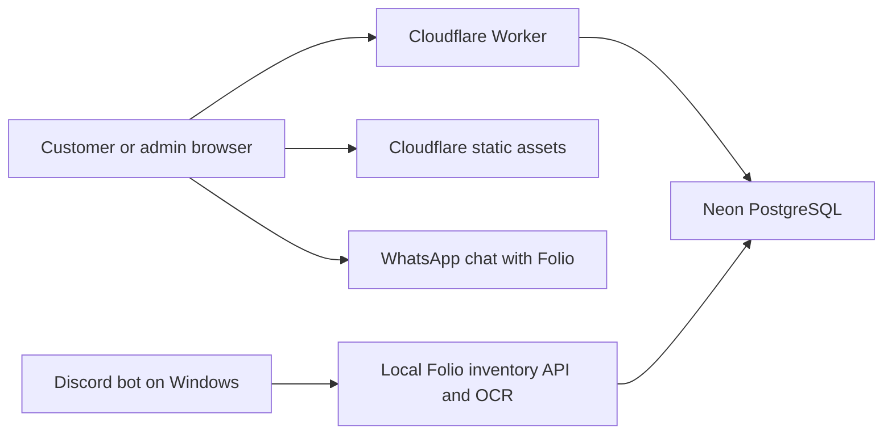

# Folio architecture

Folio is a Next.js bookstore with a storefront, an inventory console, and cash on delivery checkout. Cloudflare Workers hosts the web app, Neon PostgreSQL stores business data, and the Discord inventory bot and photo OCR run on the operator’s Windows PC.

## Frontend and request flow

The local database cache tracks the configured database URL and transport so
a configuration change replaces the previous connection. Failed initialization
can be retried. Neon uses the HTTP Drizzle adapter for ordinary statements and
the serverless adapter with Node `ws` for interactive transactions. The database
object delegates its transaction method to that WebSocket adapter so nested
savepoints and existing callers retain transactional behavior. Database HTTP
uses Undici directly, independently of Next.js rendering fetch hooks. Its transaction
pool allows three connections. This avoids direct
PostgreSQL connection timeouts observed locally and retains transactional
inventory and order operations. Other PostgreSQL hosts use `postgres`. Pools
use a 20-second connection timeout for Neon and 10 seconds for other PostgreSQL
hosts, and close after 20 idle seconds. Catalog page results include their total
count in the same read, with one retry after a failed connection. Empty pages
load a separate count to preserve pagination. Book details and uploaded photo
reads also retry one network failure. SQL validation failures are surfaced
immediately, and writes and transactions are never automatically replayed.
Each database HTTP request has a 10-second deadline so a stalled connection
cannot leave the loading fallback waiting indefinitely.
Development keeps one cart context across hot reloads to preserve the provider
identity used by streamed book controls.

- **Stack.** Next.js 16 App Router, React 19, TypeScript, and Tailwind CSS. The [root layout](../app/layout.tsx) provides the shared header, footer, typography, and cart provider.
- **Storefront.** `/` renders the searchable [catalog](../components/catalog.tsx). `/books/[slug]` reads the current listing from Neon and returns 404 for an unknown or hidden book. The Worker renders these pages on request.
- **Uploaded covers.** Identified front-cover imports save a resized, auto-oriented WebP as the listing's second image; catalog artwork stays first. One photo per listing is referenced atomically with the stock import, including deferred title choices and duplicate deliveries. The original implementation stores base64 in `book_photos`. The November 23 R2 release adds private object references, guarded local uploads, native Worker reads and verified database fallback. Existing originals are preserved. Enable local `PHOTO_STORAGE=r2` only after the new Worker passes deployment checks. The photo endpoint still serves published, priced listings only. See the R2 cutover section for release status and migrations 0014–0015.
- **Cover recognition.** The focused OCR fallback adds single-line reads with horizontal expansion for prominent, condensed lettering and retains individually confident words when surrounding artwork lowers the line score. It combines the initial and focused text so a successful author read is retained. Cover matching can verify an author against alternate names from that same Open Library author record, allowing an English name such as Homer to match the catalog's Greek name. Wrapped title phrases use their largest text height. Duplicate-work comparisons tolerate a leading article while retaining the existing edition-count dominance check. These changes recovered The Odyssey from the November 20 upload.
- **Discord availability.** The local inventory server and the Discord bot must both run for uploads and title buttons to receive replies. The bot sends a typing indicator while processing photos and replies when the inventory connection fails. After an ambiguous timeout, the operator checks stock before submitting a new message because Discord gives each resend a new identifier.
- **Title-button status.** The bot immediately replies with an explicit saving status. Once the API returns a completed title choice, it replaces the original prompt with the result and removes its buttons, then updates the private reply. Updating the public result independently lets the saved outcome remain visible if the private interaction response fails. Discord REST calls use a 10-second timeout and one retry.
- **Cart.** React handles quantity and removal controls. The [cart provider](../components/cart-provider.tsx) keeps cart items in browser `localStorage`. The [cart view](../components/cart-view.tsx) calls `/api/books` for current price and stock.
- **Checkout.** `/api/checkout` creates a pending COD request and returns a prefilled WhatsApp link plus a private status token. The shop reviews the message and approves the request from `/admin`. Approval creates the order and deducts available stock in one database transaction. On return and while visible, the browser checks `/api/checkout/status` and removes only the approved copies it still has in the cart. Pending and closed requests preserve cart quantities. See the [COD implementation](../lib/cod-order.ts) and [cart reconciliation](../components/cart-provider.tsx).
- **Admin.** `/admin` labels the credential **Admin access code**. Production verifies the code set during deployment and checks write requests against the configured HTTPS origin. In development, the local admin code takes priority and the Discord PIN is the fallback. Development uses the incoming host for origin checks because Next.js may normalize the request URL to `localhost` even when the browser uses `127.0.0.1`. The inventory and COD APIs validate the signed, HTTP-only session cookie. See [admin authentication](../lib/admin-auth.ts).
- **WhatsApp test.** The admin sender and private checkout test share the fixed Meta template and configured recipient. The checkout option requires an admin session and matches the entered phone against the server configuration. It validates the cart and uses the database rate limiter to claim one delivery attempt per cart and recipient in a 15-minute window, including during concurrent submissions or an ambiguous network timeout. It creates no order or reservation. Public checkout uses the manual WhatsApp link. The [webhook](../app/api/webhooks/whatsapp/route.ts) verifies Meta’s challenge and callback signatures and logs a generic receipt.
- **Stock history.** The edition editor loads the existing stock movement log from the authenticated [stock history API](../app/api/admin/books/stock/route.ts). Changes to available copies in the editor require a reason. The reason is written in the same transaction as the stock change and recorded by the database trigger.
- **Fulfillment.** The admin COD fulfillment section lists orders awaiting packing, shipment, or delivery. Its [orders API](../app/api/admin/cod/orders/route.ts) and the order CLI use the same transition and cancellation logic. Admin writes compare the displayed order stage and subtotal to current values so a stale view cannot pack or cancel an amended order. Shipping requires tracking. Cancellation before dispatch restores available stock in the same transaction.
- **Returns.** A shipped COD order marked refused stays in the fulfillment list while returning. Recording receipt changes the order stage. The operator then enters inspected, resellable quantities on the order lines. Returned and delivered orders can be reopened by order number. Admin restock retries use the displayed returned quantity to identify the same action, and the server caps cumulative restocking at the quantity ordered.

## Cloudflare hosting

The `folio` Worker serves [the live site](https://folio.saadalik11.workers.dev/). The [Wrangler config](../deploy/cloudflare/wrangler.jsonc) points to `.open-next/worker.js` and binds `.open-next/assets` for static files such as JavaScript, CSS, and fonts. Page rendering and API requests execute in the Worker. Open Library cover images load from their source, with Next.js image optimization disabled in the Cloudflare build.

The [build script](../scripts/build-cloudflare.mjs) stages a fresh copy of the app and runs OpenNext to turn the Next.js output into a Workers bundle. Run `npm run deploy:cloudflare` from the repository root in Ubuntu (WSL) to build and invoke Wrangler from that exact staging directory. Wrangler publishes a Worker version. This release path is currently manual. See [deployment setup](../README.md#cloudflare-workers).

The Worker receives `DATABASE_URL`, `ADMIN_PIN`, `ADMIN_SESSION_SECRET`, and `COD_WHATSAPP_NUMBER` as runtime secrets. Its [database adapter](../deploy/cloudflare/db.ts) uses Drizzle and Neon’s WebSocket driver to support interactive transactions. Database migrations run separately from the Worker deployment. See the [OpenNext Cloudflare adapter](https://opennext.js.org/cloudflare) and [Neon serverless driver](https://neon.com/docs/serverless/serverless-driver#use-the-driver-over-websockets).

## Application backup and isolated recovery

`scripts/backup.ts` creates encrypted, compressed Folio application bundles using
the existing database transport. Snapshot reads run in one repeatable-read,
read-only transaction and include all public tables, uploaded cover data,
applied migration sources, and sequence state. Each table has a canonical row
checksum. The recovery SQL reconstructs an empty database from those migrations,
loads parent tables before dependent rows with user audit triggers temporarily
disabled, reenables the triggers, and restores sequence values without reusing
numbers consumed by deleted test records. It refuses a nonempty public schema.

Verification reconstructs the original snapshot in fresh in-memory PGlite, checks
full row checksums, columns and sequence values, then tests the photo hydration
statements included in recovery SQL. It never accepts a production restore target.
Referenced and ready R2 objects are archived as encrypted image bytes with their
content-addressed keys, not just URLs. Recovery SQL materializes those bytes into
listing rows and title-choice metadata so recovery does not depend on R2 access.
Backups download objects after the consistent database snapshot; immutable keys
and checksums bind them to that snapshot. R2 usage-budget accounting writes occur
outside the snapshot; business data is read only.
AES-256-GCM authenticates the archive; bad keys and modified ciphertext fail
before any SQL is executed. The key and archives are excluded from Git. SQL
export requires `--allow-plaintext` because the resulting recovery file contains
private customer data. Keep off-device archive and key copies separately.

This provides a recovery path while native PostgreSQL clients are unavailable
on the operator's PC. It covers Folio's migration-managed public schema, not
roles, account configuration, arbitrary extensions, non-public schemas, or
Cloudflare runtime secrets. The exporter refuses source application relations
over 64 MiB and external photo payloads over 64 MiB; total portable archive JSON
is limited to 128 MiB. Use a dedicated object backup before reaching that photo
limit; `pg_dump` alone does not preserve R2 object bytes. Native unpooled `pg_dump`
is the documented path for larger or
independently managed databases. A fresh-target recovery and a verified cutover
are the rollback procedure; the tool does not overwrite production or reverse
individual migrations. Account-specific Neon retention, off-device copies, and
backup scheduling remain operational follow-ups in the backlog.

On November 21, the first live application backup restored successfully into
isolated PGlite: 15 tables, 106 rows, two uploaded photos, and seven sequences
matched. Source Postgres was 18.7 and the restore engine was 18.6. The exact
generated recovery SQL was reverified against the saved encrypted archive after
implementation. No plaintext recovery file was exported and production was
read only. Tests also cover authenticated encryption failure, nonempty-target
refusal, pending-migration exclusion, schema drift, and sequence gaps. The
archive and local key still need separate off-device storage, and the Neon
project's configured history window has not been inspected. A daily reminder
was subsequently configured for 9 PM America/Toronto, prompting the operator
to run the backup command manually. It does not execute backups or resume
other paused backlog work. Off-device storage remains deferred.

## Design decisions

| Decision | Reason and operational effect |
| --- | --- |
| Run Next.js and the API in one Worker | The storefront and admin share a deployment, origin, and API. |
| Use Neon as the shared database | The Worker and local inventory API see the same listings, stock, and orders. Stock reservations and order creation use a transaction. |
| Keep Discord and OCR local | The storefront and admin can operate while the PC is off. Discord imports require both the local bot and the inventory API to be running. The Worker build excludes the Discord, SMS, Telegram, and legacy Stripe routes. |
| Track stock per listing and confirm ambiguous matches | Stock commands resolve the listing by ISBN, explicit `slug:`, or an unambiguous match. Discord asks the operator to confirm an edition when listings share a title. Barcode commands use the scanned ISBN. Stock changes continue to be recorded by the database audit trigger. |
| Share the listing price limit between admin and Discord | Both paths use the same Rs 1,000,000 maximum in [store policy](../lib/store-policy.ts) and accept up to two decimal places. |
| Disable Cache Components and partial prefetching in both builds | Database-backed pages use request-time rendering locally and in production, avoiding staged rendering that can leave the catalog fallback unresolved. Book pages resolve the slug before returning a listing or 404. |
| Use manual WhatsApp confirmation | The customer sends a prefilled reference, and the shop verifies the sender and approves in admin. The handoff uses a link and the operator confirms the order manually. |
| Reconcile the cart after server approval | Browser storage tracks the submitted copy IDs and a signed status token. The WhatsApp message carries the reference alone. The status endpoint returns only the request state, so an unsent message, expiration, or quantities added later cannot clear the cart. Rotating the signing secret invalidates previously issued status tokens. |
| Add verified follow-ups to the existing unshipped COD order | Matching name and address keep the fulfillment destination consistent. Approval reserves the added stock and recalculates one shipping fee in the same transaction. A packed order returns to the packing queue. Follow-up references remain linked to the order after request cleanup so status checks and approval retries resolve correctly. |
| Offer COD nationwide in Pakistan without the Rs 5,000 order cap | The customer enters a city or town and a Pakistani mobile number. The operator reviews the address during WhatsApp approval. Rs 5,000 is the free-shipping threshold. The server guards against amounts that overflow the database's integer columns. |

## Keeping this knowledge base current

### R2 billing controls

The operator activated R2 and configured account-wide $1 warning and $5 urgent
budget email alerts on November 23, alongside Cloudflare's auto-created $10 alert.
The screenshot shows one recipient each and zero spend, but labels the period
Dec 2026; billing-period coverage and email delivery remain unverified. These
alerts do not stop R2 usage or cap its bill, and are separate from free-tier
resource thresholds. The copy and reference preparation status is recorded below.

### R2 photo copy stage (November 23)

The destination is the private Standard-class bucket `folio-photos`. The operator
created it and configured bucket-scoped credentials in ignored local settings.
An encrypted pre-migration backup created at 12:15 UTC on November 23 passed its
isolated restore check: 16 tables, 113 rows, two photos and seven sequences.
Migration 0014 was then applied to the shared database. Both listing photos
(two unique objects, 184,618 bytes total) were copied and downloaded for SHA-256
verification. A separate `--verify` run passed for both reserved objects.
Before/after record counts and checksums confirmed the original books, orders,
order lines, returns, uploaded photos and stock history unchanged. No Neon
photo bytes were deleted; Worker serving and inventory imports still use Neon.

`npm run photos:migrate -- --plan` reads the saved listing photos without writing.
The November 23 plan found two unique photos totaling 184,618 decoded bytes.
With bucket-scoped Object Read & Write credentials in local environment variables
and migration 0014 applied, `--copy` reserves capacity, copies sequentially, and verifies each downloaded copy
by SHA-256. It never removes or changes the original `book_photos` rows.
`--verify` checks all reserved objects, including uncertain prior uploads.
The existing storefront URL and authenticated local import continue using Neon.
The R2-enabled Worker release and local import activation status are recorded below.
Neon original reclamation and historical title-choice cleanup remain pending until
production serving and a new upload are verified.

The fixed copy policy is 512 KiB per optimized WebP, 8,000,000,000 total tracked
bytes, and 10,000 PUT attempts per UTC calendar month. A transaction-scoped global
advisory lock reserves bytes and one attempt before external work. Content-addressed
keys deduplicate identical permanent images. Reservations survive failure/crashes;
permanent reservations are not released automatically. Temporary reservations
are released only after confirmed cleanup deletion. Repeat copies refuse unresolved objects until a
checksum verification succeeds. Requests use one PUT with no automatic retries,
a create-only condition, private signed S3 access, bounded reads and deadlines.
Ready objects are skipped by `--copy`; run `--verify` before any future cutover.

These are application controls for this tool, database ledger and single bucket,
not an account spending stop. Direct dashboard/API uploads, other applications,
other buckets and object retention outside this ledger remain outside the
limit. Keep the ledger and credentials tied to the same bucket/account; never
reset the ledger or switch destinations to bypass an unresolved upload. The
8 GB ceiling intentionally leaves headroom, but free-tier eligibility and billing
periods still require account review. No continuous quota polling was added.

### R2 cutover (November 23; production deployed)

Migration 0015 adds nullable `book_photos.object_key` and a monthly read counter.
The pre-migration encrypted backup restored successfully with 18 tables and both
checksum-matched object originals. Both existing photos were then freshly verified
and linked to their R2 keys without deleting their database bytes. Before/after
checksums confirmed original books, orders, lines, returns, stock history and
inline photo bytes unchanged. Direct local R2 reads matched both originals.
The subsequent `folio-2026-11-23T13-14-38.247Z-625e07.foliobackup` passed restore:
18 tables, 118 rows, two photos, two archived R2 objects and seven sequences.

The Cloudflare build replaces `lib/photo-store.ts` with the native binding adapter
and binds `PHOTO_BUCKET` to private `folio-photos`. S3 keys stay local; the Worker
does not need them. The same published/priced database gate precedes object access,
and both transports verify the object content hash. The existing URL and no-store
policy remain. Missing/corrupt/unavailable R2 reads use a preserved inline original;
without one they return 503, rather than exposing another image. The diagnostic
`X-Folio-Photo-Storage` header reports the actual source, allowing deployment checks
to reject a silent fallback. Draft requests cannot consume an R2 read.

All controlled R2 downloads reserve a read attempt atomically before access, capped
at 1,000,000 per UTC calendar month, including migration verification and backups.
Failed reads remain counted; there are no object-read retries. The limits cover
Folio paths, not direct Cloudflare/S3 use or another application. Accounting adds
a database write to R2 reads; ordinary storefront traffic already queries Neon,
and no background poller was added. Budget exhaustion can return 503 for R2-only
images; preserved originals continue to work.

With local `PHOTO_STORAGE=r2`, front-cover processing uploads and verifies the
object before queueing a title choice or adding stock. The metadata and listing
store only a key for new uploads, avoiding duplicate base64 payloads. The existing
claim/stock transaction validates the ready key, including deferred confirmation;
storage failure adds no stock. The flag was enabled after independent production
R2 checks passed, and supervised local services were restarted. Existing pending
base64 choices still resolve. A new front-cover Discord import is still required
to complete live acceptance.

The detached restart did not survive in the agent execution environment; a
persistent foreground supervisor session restored the configured/OCR-ready local
API and the connected, ready Discord bot. Windows-logon startup acceptance remains
separately tracked; the production Worker does not depend on this local process.

Rollback to pre-R2 code requires stopping new R2 imports (unset PHOTO_STORAGE),
then `npm run photos:migrate -- --rollback` before deploying the old Worker/local
code. This downloads and verifies R2-only listing and title-choice bytes, uses
compare-and-set writes to materialize legacy fallbacks, and never changes stock.
Keep the additive schema. It is idempotent; stop on any error. If R2 is unavailable,
recover the encrypted backup into a new database, verify it and perform a controlled
database cutover instead. Isolated tests cover both rollback paths. No old-code
rollback has been performed. Verified inline-payload reclamation is recorded below.

`scripts/prepare-photo-release.mjs` builds a credential-free source snapshot with
file checksums and known public photo hashes. The prepared Linux launcher builds
and deploys it, runs existing production smoke checks, then requires actual R2
responses and matching checksums for both published photos. Windows still rejects
WSL launch from the agent with Wsl/E_ACCESSDENIED, so the operator must execute the
prepared launcher in their session. The operator deployed snapshot
`release-r2-20261123-V4MpuM` as version `c1ffb35f-4b6d-4071-abfd-7616e9ee12c6`.
Release smoke checks and independent actual-R2/header/checksum checks passed for
both existing photos. The subsequent recovery, local fallback workflow, and
database reclamation are recorded below. The release is a checksummed
working-tree snapshot based on 15477538594cf29f430e3d8202931eb55f094bf1, not a claim
that the R2 implementation has already been committed or pushed.

The first new-photo acceptance attempt on November 23 exposed a recognition
limitation: The Complete Stories cover uses a cursive title and rotated F. Kafka
credit, neither recovered by the initial/focused OCR passes. A subsequent barcode
scan identified ISBN 9780805210552 and created draft 125 with one copy. The original
failed cover was then recovered for that operator-confirmed same book, optimized,
uploaded through guarded R2 storage and linked without changing stock or any book
fields; downloaded bytes matched. The public prompt and private title-button
acknowledgment repeat the success text, but the database contains one import and
one +1 movement. This manual recovery verifies actual new-photo storage, not a
successful automatic front-cover recognition test. Typography recognition and
safe association of a failed cover with a subsequent barcode remain backlog work.
The follow-up archive `folio-2026-11-23T14-09-17.223Z-273962.foliobackup`
passed isolated restore with 18 tables, 124 rows, three listing photos, three
archived R2 objects and seven sequences, including the recovered Kafka cover.

### Failed-cover and barcode confirmation (local workflow)

Migration 0016 adds `pending_covers` and `cover_barcode_choices`. When cover
identification still fails, the authenticated importer saves an optimized private
WebP under `pending/<random-id>/<content-hash>.webp` for 15 minutes. It binds the
record to source message, Discord user and channel, and retains the requested
quantity. A duplicate delivery reuses the record; no stock is added. Retention is
capped at four active covers per user/channel and 32 globally, in addition to R2
byte, PUT and read budgets. If storage is unavailable the bot says it could not
retain the image; it does not falsely claim success.
R2 PUTs explicitly set Content-Length: Next.js can otherwise stream the signed
request without a length and R2 rejects it with HTTP 411. The real local HTTP
check exposed this difference from direct CLI uploads; transport tests now assert
the exact length header.

An ADD barcode scan by that same user/channel now pauses when retained covers
exist. The bot fetches previews from a secret-authenticated local endpoint, shows
up to four labeled image attachments and asks which is the same physical book.
Nothing is auto-associated. Wrong account/channel, unoffered IDs, expired covers,
and already-used covers are rejected. Preview failure hides confirmation buttons.
Barcode-only and cancellation options remain explicit. The original retained
quantity applies unless the barcode caption explicitly supplies a quantity.

Confirmation locks the barcode request and claims the selected cover with a short
processing lease. It verifies/downloads the temporary image and promotes it to a
separate permanent `covers/` object before atomically importing stock or queueing
the English/original title choice. The stock claim uses the barcode message ID,
so repeats and concurrent clicks cannot receive it twice. Title selection, if
needed, still precedes stock receipt. Failed promotion leaves stock unchanged;
retries cannot extend a processing lease indefinitely. Once used, the temporary
object expires immediately; permanent objects are never eligible for this cleanup.

The local supervisor scans cleanup deadlines once at startup and sleeps until
known expiry. The API notifies its authenticated loopback control endpoint before
replying, with bot IPC as another notification path. Thus a lost Discord response
does not normally lose the cleanup deadline. No periodic empty-table polling was
added. Confirmed DELETE precedes ledger-capacity release; errors retain the
reservation and schedule a ten-minute retry. If the PC is asleep/off, access
expires on time but physical deletion waits for resume/startup. This is a local
service responsibility, not a Cloudflare cron or a new cloud subscription.

Temporary images are intentionally excluded from encrypted backups; immutable
permanent listing/title-choice images remain included. Recovery does not resurrect
expired image bytes. Minimal request tombstones remain for duplicate protection.
The Worker excludes Discord routes, so these changes do not require another
Cloudflare deployment. Completed title/cover actions now acknowledge privately
with a short reference to the updated public prompt rather than duplicating the
full stock-success message. Isolated tests cover ownership, preview protection,
expiry, quantities, selection, replay/concurrent confirmation, failed promotion,
cleanup, scheduler wakeups and permanent-photo backup recovery.

### Reclaiming legacy photo payloads

`photos:migrate --prepare-reclaim` prepares permanent copies for legacy listing
photos and terminal/expired title-choice payloads without deleting anything.
Create a fresh encrypted backup after this step. `--reclaim BACKUP_FILE` opens
and restore-verifies the archive, requires matching archived rows and image bytes,
downloads and verifies live R2 bytes, then clears only those inline payloads in
one compare-and-set transaction. Title metadata keeps a permanent object key;
active pending choices are untouched. No book, quantity, order or stock-audit
update is performed. Replays are harmless. The archive and the rollback helper
can still materialize legacy bytes if needed. Actual cleanup results are recorded
in the backlog; this mechanism must not be replaced with a blanket SQL deletion.

On November 23 the old payloads were prepared, then encrypted archive
`folio-2026-11-23T15-31-41.412Z-39e9b1.foliobackup` passed restore verification.
The guarded command cleared two listing payloads and two terminal title-choice
payloads (492,320 logical text bytes) atomically. Physical database storage may
reclaim dead tuples later; this is not a claim of an immediate billing reduction.
All three listing photos now have no inline data and use permanent R2 references.
Independent checks verified all three published image URLs served matching R2
bytes and books, quantities, orders, lines, returns and stock/import audits matched
the pre-cleanup archive. The cleaned-state archive
`folio-2026-11-23T15-34-39.293Z-cddc49.foliobackup` also passed: 20 tables,
127 rows, three photos/archived R2 objects and seven sequences.

The actual local HTTP workflow was exercised with the previously unrecognized
Kafka cover: retain privately, scan its barcode, fetch the correct authenticated
preview and cancel. No stock import occurred. Temporary object and test records
were removed. Early attempts exposed missing Content-Length (fixed) and transient
database-read failures; cleanup was verified separately. Operator catalog edits
made during those checks were preserved. The local API and bot report ready;
next-book preview/button acceptance in Discord remains the final operator UI check.
R2 deletion does not delete original Discord uploads or purge Discord CDN caches.

### Production monitoring checks

The dependency-free `scripts/monitor-production.mjs` checks the existing public
storefront, database-backed availability endpoint, and unauthenticated admin
boundary. It performs only GET requests, rejects redirects, bounds response size
and time, and retries one failed read. Full HTML is consumed so a streamed catalog
failure with HTTP 200 can fail the check. An empty availability result is healthy:
the valid positive ID still executes the database query. The monitor needs no
admin or database credentials and does not create orders, imports, or messages.
It logs safe status/timing summaries rather than responses or exception details.

The GitHub Actions workflow runs hourly on a standard Linux runner, with read-only
repository permission and no npm dependency installation. This keeps monitoring
independent of the local PC and requires no paid monitoring account. Hourly reads
may wake Neon, but allow autosuspension between runs; low-frequency polling is an
intentional free-tier tradeoff. GitHub failure email requires the operator's
notification settings and scheduled-workflow ownership. An explicit manual-only
notification test fails deliberately without changing production. Schedules can
be delayed or disabled by GitHub inactivity rules, so these are smoke checks,
not guaranteed continuous monitoring. Push-triggered and normal manual checks passed on GitHub; the operator confirmed failure-test email delivery on November 22, 2026. On November 23, three recent scheduled runs were verified successful under actor Saad-Ali-Khan; scheduled execution and operator attribution are confirmed.

Cloudflare/Neon account usage is a separate concern. The workflow cannot measure
CU-hours, account-wide requests, storage, or transfer from public storefront
responses. Actual allowances, provider alert eligibility, recipients and billing
controls must be checked in the account dashboards. The proposed warning/urgent
thresholds are 80%/90%; no account-level alerts are claimed as installed. The
README documents review steps and rollback; the release-history JSON records
verified deployments without inventing a source SHA. Rollback stays an explicit
operator decision because older code may not match current schema or bindings.

### Local inventory service supervision

`scripts/local-services.ts` supervises the local Next webpack development server
and Discord bot without adding a hosted worker or paid supervisor. This keeps OCR
and Discord on the operator's PC. `local:up` launches hidden; `local:status` reads
authenticated loopback control; `local:stop` stops only children of that launcher.
Exclusive PID/nonce locks reject duplicate supervisors and bot sessions. Stale
locks are recovered only when the recorded process no longer exists. Unknown or
uninspectable processes are left alone. Port 3000 must be available before launch.

The local-only `/api/local/health` route requires the inventory shared secret,
returns uncached configuration/image-library/OCR-asset readiness, and is excluded
from Cloudflare staging alongside the Discord routes. It deliberately does not
query Neon: a 15-second database probe would prevent free-tier autosuspension.
Readiness is not a database or full OCR import test. Discord sends a local IPC
heartbeat every ten seconds. Crashes use exponential backoff capped at a minute;
Gateway/heartbeat loss lasting 90 seconds triggers recovery. Three API failures
suspend the bot, and API recovery has a two-minute grace. Import writes are never
automatically replayed. Existing source-message idempotency remains the safeguard
when an interrupted import is inspected and retried by the operator.

Private runtime/control files and logs live in Git-ignored `.folio-local`.
Control binds only to loopback and requires a random per-launch bearer token.
Logs redact configured secret values and database URLs, assemble complete lines
before redaction, drop oversized lines, and rotate at 5 MiB with two archives per
component. A prepared current-user, limited-privilege Windows logon task launches
hidden and avoids storing credentials. Its installation was blocked in the agent
environment, but the operator subsequently registered it successfully. A post-logon check remains backlog work.
PC sleep, logout, network loss, or shutdown can still interrupt imports. The
Cloudflare storefront continues to operate separately against the shared database.

Update this page in the same change whenever routes, rendering, data flows, authentication, integrations, or deployment change. For a significant design decision, record what changed, why, and what it means for running the store. Put proposed changes and unresolved issues in the [backlog](../BACKLOG.md). Keep credentials and customer data out of the documentation.

### Cover artwork and edition identity

`book_editions` stores structured publisher, translator, language, edition/printing,
an evidence note, review status, optimistic revision and bounded catalog proposals
beside the stable `books` row. A separate table keeps older deployed code compatible
with the additive migration. New cover imports retain close candidate sources and
artwork even when visual scores are tied; storing proposals never sets reviewed
fields or a physical ISBN. Refresh runs in the authenticated, same-origin local-only
`/api/admin/books/edition/candidates` route and is excluded from Cloudflare builds.
The cloud admin can read/review proposals already stored in Neon. Search is bounded
by existing catalog/image budgets and three requests per listing per minute.

The admin form saves book edits and edition edits in one transaction. Metadata
revision and expected ISBN prevent stale saves, including concurrent import or
candidate refresh. Edition-only changes create no stock movement. Candidate cover
application is explicit. Changing a structured field clears review in the GUI;
reviewed values require an evidence note. Public pages render reviewed, nonempty
metadata or exact catalog-supported fields for the linked canonical ISBN. The
latter are explicitly attributed to the matching catalog; unsupported manual
values stay hidden and review status is not changed. Multiple same-ISBN sources
are ranked by agreement with saved fields. Public pages no longer claim every
book is a paperback. Unknown work
keys display as “Not verified” rather than masquerading as an ISBN. Evidence notes
and candidate lists remain admin-only. Existing generated description notes are
preserved; review those notes too when correcting previously unverified details.

Proposal application was extended after operator GUI feedback on November 22:
the button fills all available edition fields and stages an ISBN for a manual
work key, while clearing reviewed/physical-confirmation state. Missing fields stay
blank. Only the existing save transaction can persist or link it. Readings detail
enrichment fetches at most five exact `/api/books/{id}` records within the existing
12-second budget and 1 MB response bound, checking record ID, ISBN, title and author
against the compared artwork record. It maps recognized language codes and records
binding/publication year without claiming a numbered printing. It never extracts
a translator from marketing prose or related books. Open Library uses explicit
translator contributors, language and edition name; Google Books contributes
language and labeled publication year. Old stored proposals remain valid but need
a refresh to gain these fields. A pure client staging helper is regression-tested
for populated fields, missing metadata, and retention of all ISBN protections.

The November 23 Little Prince GUI check exposed an overly strict proposal filter:
the actual saved photo and the matching Readings jacket had grayscale distance
about 0.279 and exposure-adjusted color distance about 0.120, outside the former
review pool despite matching artwork. Review-only proposals now also accept gray
distance up to 0.32 when color distance is at most 0.18, in addition to the old
0.22/0.22 pool. They are labeled possible; the automatic 0.16/0.16 criteria and
runner-up gap are unchanged. A direct read-only replay of the actual photo found
Readings record 950841 with English and paperback/published 2016, without assigning
a cover or ISBN. Framing/exposure and wrong-cover regressions protect that boundary.

Linking a manual work key to a physical ISBN validates the checksum, canonicalizes
ISBN-10 to ISBN-13 and requires physical-copy attestation. The server records that confirmation and a matching stored catalog source automatically; the operator may add an optional note. The ID,
slug, photos and order references remain stable; metadata operations never merge
listings or transfer stock. A collision aborts the entire edit. The immutable SQL
`folio_isbn_key` function and expression unique index protect canonical aliases
across concurrent writers. Invalid legacy keys return NULL and retain their raw
uniqueness constraint. Existing aliases that collide stop migration, rather than
silently repairing data. Imports match canonical valid ISBNs. Existing different
ISBNs cannot be replaced in this workflow. Deletion checks metadata revision as
well as existing book snapshots and reservation/order safeguards; metadata cascades
only when a safe listing deletion succeeds. Backup/restore regression includes
the new migration-managed table, function and index.

November 23 GUI feedback showed saved publisher/language/edition values hidden
behind the separate review checkbox after physical ISBN linking. ISBN-backed,
per-field catalog attribution now avoids that redundant visibility gate without
publishing unknown translators. Applying catalog details stages its cover by
default, and an existing ISBN rejects a differently identified catalog cover.
At the operator's explicit request, Little Prince listing 119's primary artwork
was changed to Readings record 950841. Transaction checks preserved every other
book field and the uploaded-photo checksum. Local HTML checks confirmed that
cover, publisher, English, paperback/published 2016 and source attribution render.

Cover-only OCR identifies a work and author without verifying publisher, translator, or ISBN. `lib/publisher-cover.ts` and `lib/cover-catalogs.ts` search Readings, Open Library editions, and Google Books concurrently. They require matching title and author (Open Library editions must reference the already identified work), apply recognized visible publisher/imprint clues, and compare up to six candidate covers per source with the uploaded photo using normalized grayscale and exposure-adjusted spatial color layout. Open Library examines the first 40 edition records; Google Books requests 20 search results. Three small crop variants tolerate framing differences. Conservative distance thresholds and a minimum gap between candidates reject weak or ambiguous matches. Repeated catalog ISBN evidence is grouped across sources before checking ambiguity, without assigning that ISBN to inventory. This is an artwork heuristic, not proof of edition identity.

A successful match supplies catalog artwork while retaining the uploaded photo as the second listing image. Its source URL and explicit ISBN/translator uncertainty are saved in the draft description and survive a pending title choice. Artwork matching never assigns an ISBN or infers a translator. Unknown or unavailable matches keep the original work metadata with an empty catalog cover. Requests use fixed source hosts, encoded search terms, no redirects, response size and pixel limits, and a 12-second network budget. Catalog discovery has a four-second deadline; image downloads run four at a time. Returned Google image URLs must use the exact approved host/path before HTTPS fetching. No paid search service is required; optional `GOOGLE_BOOKS_API_KEY` uses the operator's API quota. Google Books returned HTTP 429 in the November 20 live check; Open Library edition lookup returned HTTP 200. Source errors are isolated so other catalogs continue. Direct adapters for other publisher websites and unrestricted web search are not implemented. ISBN imports bypass this heuristic. Published listings are not silently rescanned or restocked.

On November 20, 2026, the Odyssey listing's incorrect Stephen Mitchell artwork was replaced with the visually matching Readings bird-and-waves cover through this resolver. Its manual work key, one-copy stock, and uploaded photo were preserved. The translator remains unverified because the matching catalog record does not name one. Full title/copyright pages are not fetched or fabricated.

### Production release, November 20, 2026

The subsequent cataloging release was built/deployed November 23 from exact source
`d89764720a10b6e58be8ef368fb69d4823ee468f`, Linux folder
`release-cataloging-20261123-o3WaNu`. GitHub main was independently verified at
that commit. Operator deployment checks passed for storefront/database/admin
protection, Odyssey/photo/admin pages, authenticated-only edition reads (401)
and exclusion of local candidate refresh (404). Independent live Little Prince
checks confirmed the Readings cover, publisher, English, 2016 publication details
and catalog attribution. The operator subsequently supplied Worker version
`3265780b-d44b-417d-8a85-c3e32a276c1a` from this release's deployment log.
Operator post-save screenshots and an independent persisted-record read confirmed
Little Prince edition revision 5, reviewed status and saved Readings/English/2016
details. Release verification is complete. The November 20 record below is history.

Cloudflare Worker version `3d1d7633-3771-453c-a8d5-96e0445d994f` was deployed from the prepared `release-20261120-cover-catalogs` Linux source snapshot. The deployment checks returned HTTP 200 for the home page, Odyssey book page, uploaded photo, admin sign-in page, and cart. Independent requests also verified the matching Readings artwork, second-photo URL, edition uncertainty note, and the 134,864-byte uploaded image. These are read-only checks; no checkout, stock adjustment, or authenticated admin write was performed during deployment verification. Discord, OCR, and artwork discovery remain local services against the shared database, as designed.

On November 21, production title editing was verified by the operator in Chrome, including saving a temporary title and restoring it. An independent reload confirmed the restored draft and all original editor fields, with stock still at nine copies. The in-app browser had returned “Failed to fetch” for its save attempt; Chrome completed both saves. Treat an ambiguous save response as unknown until reloading and checking the saved state, rather than resubmitting immediately. Subsequent publishing, stock, and order API verification is recorded below.

Later on November 21, authenticated production API checks passed for publishing and stock adjustments using disposable listing #121. Missing price and missing adjustment reason were rejected; a positive-price, zero-stock listing rendered as sold out; returning it to draft produced 404; draft stock changes persisted with audit reasons and were restored to zero. The operator entered the admin code privately through a local PowerShell runner. Cleanup deleted the fixture, and independent queries verified all 23 original listings against their pre-test checksum and retained the synthetic adjustment audit records. No customer order was touched. These API checks complement the Chrome title-edit check.

Fulfillment and returns were then verified through the production APIs using three seeded synthetic orders (#4–6) and hidden listings (#122–124). The checks covered cancellation and one-time stock restoration, packing, required tracking, shipment, delivery, stale snapshots and invalid transitions, refusal, receipt without automatic restocking, item ownership, quantity caps, partial returns, and safe replay of inspected-copy restocks. All 13 checks passed. Cleanup removed the synthetic orders, lines, return claims, and listings; an independent database comparison confirmed the original books, orders, order lines, and returns matched their pre-test checksums. Synthetic stock audit records remain. No customer messages, courier bookings, cash settlement, or remittance occurred. Fixtures were seeded directly, so these checks validate fulfillment endpoints rather than creation of a new checkout or WhatsApp approval.
