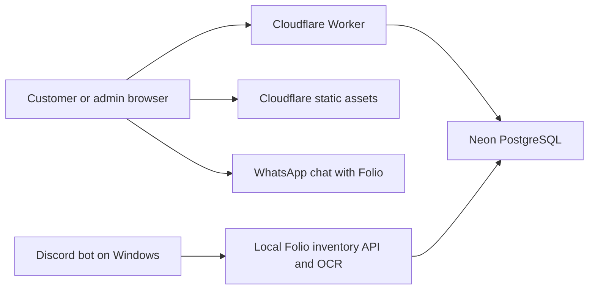

# Folio architecture

Folio is a Next.js bookstore with a storefront, an inventory console, and cash on delivery checkout. Cloudflare Workers hosts the web app, Neon PostgreSQL stores business data, and the Discord inventory bot and photo OCR run on the operator’s Windows PC.

## Frontend and request flow

The local database cache tracks the configured database URL and transport so
a configuration change replaces the previous connection. Failed initialization
can be retried. Neon uses the HTTP Drizzle adapter for ordinary statements and
the serverless adapter with Node `ws` for interactive transactions. The database
object delegates its transaction method to that WebSocket adapter so nested
savepoints and existing callers retain transactional behavior. Database HTTP
uses Undici directly, independently of Next.js rendering fetch hooks. Its transaction
pool allows three connections. This avoids direct
PostgreSQL connection timeouts observed locally and retains transactional
inventory and order operations. Other PostgreSQL hosts use `postgres`. Pools
use a 20-second connection timeout for Neon and 10 seconds for other PostgreSQL
hosts, and close after 20 idle seconds. Catalog page results include their total
count in the same read, with one retry after a failed connection. Empty pages
load a separate count to preserve pagination. Book details and uploaded photo
reads also retry one network failure. SQL validation failures are surfaced
immediately, and writes and transactions are never automatically replayed.
Each database HTTP request has a 10-second deadline so a stalled connection
cannot leave the loading fallback waiting indefinitely.
Development keeps one cart context across hot reloads to preserve the provider
identity used by streamed book controls.

- **Stack.** Next.js 16 App Router, React 19, TypeScript, and Tailwind CSS. The [root layout](../app/layout.tsx) provides the shared header, footer, typography, and cart provider.
- **Storefront.** `/` renders the searchable [catalog](../components/catalog.tsx). `/books/[slug]` reads the current listing from Neon and returns 404 for an unknown or hidden book. The Worker renders these pages on request.
- **Uploaded covers.** Identified front-cover imports save a resized, auto-oriented WebP in `book_photos` as the listing's second image. The catalog cover stays first. One photo per listing limits storage, and the latest successful cover import replaces that slot. The photo is stored atomically with the inventory import and survives deferred title selection and duplicate Discord deliveries. PostgreSQL storage makes the photo available to Cloudflare while OCR runs locally, without depending on expiring Discord attachment URLs or adding a storage service. The image endpoint serves published, priced listings only. Apply migration `0011_book_photos.sql` before deploying the page or restarting the updated local importer.
- **Cover recognition.** The focused OCR fallback adds single-line reads with horizontal expansion for prominent, condensed lettering and retains individually confident words when surrounding artwork lowers the line score. It combines the initial and focused text so a successful author read is retained. Cover matching can verify an author against alternate names from that same Open Library author record, allowing an English name such as Homer to match the catalog's Greek name. Wrapped title phrases use their largest text height. Duplicate-work comparisons tolerate a leading article while retaining the existing edition-count dominance check. These changes recovered The Odyssey from the November 20 upload.
- **Discord availability.** The local inventory server and the Discord bot must both run for uploads and title buttons to receive replies. The bot sends a typing indicator while processing photos and replies when the inventory connection fails. After an ambiguous timeout, the operator checks stock before submitting a new message because Discord gives each resend a new identifier.
- **Title-button status.** The bot immediately replies with an explicit saving status. Once the API returns a completed title choice, it replaces the original prompt with the result and removes its buttons, then updates the private reply. Updating the public result independently lets the saved outcome remain visible if the private interaction response fails. Discord REST calls use a 10-second timeout and one retry.
- **Cart.** React handles quantity and removal controls. The [cart provider](../components/cart-provider.tsx) keeps cart items in browser `localStorage`. The [cart view](../components/cart-view.tsx) calls `/api/books` for current price and stock.
- **Checkout.** `/api/checkout` creates a pending COD request and returns a prefilled WhatsApp link plus a private status token. The shop reviews the message and approves the request from `/admin`. Approval creates the order and deducts available stock in one database transaction. On return and while visible, the browser checks `/api/checkout/status` and removes only the approved copies it still has in the cart. Pending and closed requests preserve cart quantities. See the [COD implementation](../lib/cod-order.ts) and [cart reconciliation](../components/cart-provider.tsx).
- **Admin.** `/admin` labels the credential **Admin access code**. Production verifies the code set during deployment and checks write requests against the configured HTTPS origin. In development, the local admin code takes priority and the Discord PIN is the fallback. Development uses the incoming host for origin checks because Next.js may normalize the request URL to `localhost` even when the browser uses `127.0.0.1`. The inventory and COD APIs validate the signed, HTTP-only session cookie. See [admin authentication](../lib/admin-auth.ts).
- **WhatsApp test.** The admin sender and private checkout test share the fixed Meta template and configured recipient. The checkout option requires an admin session and matches the entered phone against the server configuration. It validates the cart and uses the database rate limiter to claim one delivery attempt per cart and recipient in a 15-minute window, including during concurrent submissions or an ambiguous network timeout. It creates no order or reservation. Public checkout uses the manual WhatsApp link. The [webhook](../app/api/webhooks/whatsapp/route.ts) verifies Meta’s challenge and callback signatures and logs a generic receipt.
- **Stock history.** The edition editor loads the existing stock movement log from the authenticated [stock history API](../app/api/admin/books/stock/route.ts). Changes to available copies in the editor require a reason. The reason is written in the same transaction as the stock change and recorded by the database trigger.
- **Fulfillment.** The admin COD fulfillment section lists orders awaiting packing, shipment, or delivery. Its [orders API](../app/api/admin/cod/orders/route.ts) and the order CLI use the same transition and cancellation logic. Admin writes compare the displayed order stage and subtotal to current values so a stale view cannot pack or cancel an amended order. Shipping requires tracking. Cancellation before dispatch restores available stock in the same transaction.
- **Returns.** A shipped COD order marked refused stays in the fulfillment list while returning. Recording receipt changes the order stage. The operator then enters inspected, resellable quantities on the order lines. Returned and delivered orders can be reopened by order number. Admin restock retries use the displayed returned quantity to identify the same action, and the server caps cumulative restocking at the quantity ordered.

## Cloudflare hosting

The `folio` Worker serves [the live site](https://folio.saadalik11.workers.dev/). The [Wrangler config](../deploy/cloudflare/wrangler.jsonc) points to `.open-next/worker.js` and binds `.open-next/assets` for static files such as JavaScript, CSS, and fonts. Page rendering and API requests execute in the Worker. Open Library cover images load from their source, with Next.js image optimization disabled in the Cloudflare build.

The [build script](../scripts/build-cloudflare.mjs) stages a fresh copy of the app and runs OpenNext to turn the Next.js output into a Workers bundle. Run `npm run deploy:cloudflare` from the repository root in Ubuntu (WSL) to build and invoke Wrangler from that exact staging directory. Wrangler publishes a Worker version. This release path is currently manual. See [deployment setup](../README.md#cloudflare-workers).

The Worker receives `DATABASE_URL`, `ADMIN_PIN`, `ADMIN_SESSION_SECRET`, and `COD_WHATSAPP_NUMBER` as runtime secrets. Its [database adapter](../deploy/cloudflare/db.ts) uses Drizzle and Neon’s WebSocket driver to support interactive transactions. Database migrations run separately from the Worker deployment. See the [OpenNext Cloudflare adapter](https://opennext.js.org/cloudflare) and [Neon serverless driver](https://neon.com/docs/serverless/serverless-driver#use-the-driver-over-websockets).

## Application backup and isolated recovery

`scripts/backup.ts` creates encrypted, compressed Folio application bundles using
the existing database transport. Snapshot reads run in one repeatable-read,
read-only transaction and include all public tables, uploaded cover data,
applied migration sources, and sequence state. Each table has a canonical row
checksum. The recovery SQL reconstructs an empty database from those migrations,
loads parent tables before dependent rows with user audit triggers temporarily
disabled, reenables the triggers, and restores sequence values without reusing
numbers consumed by deleted test records. It refuses a nonempty public schema.

Verification executes that exact SQL against a fresh in-memory PGlite database;
it never accepts a production restore target. Full row checksums, columns,
photos, and sequence values are checked before emitting a verification report.
AES-256-GCM authenticates the archive; bad keys and modified ciphertext fail
before any SQL is executed. The key and archives are excluded from Git. SQL
export requires `--allow-plaintext` because the resulting recovery file contains
private customer data. Keep off-device archive and key copies separately.

This provides a recovery path while native PostgreSQL clients are unavailable
on the operator's PC. It covers Folio's migration-managed public schema, not
roles, account configuration, arbitrary extensions, non-public schemas, or
Cloudflare runtime secrets. The exporter refuses source application relations
over 64 MiB; native unpooled `pg_dump` is the documented path for larger or
independently managed databases. A fresh-target recovery and a verified cutover
are the rollback procedure; the tool does not overwrite production or reverse
individual migrations. Account-specific Neon retention, off-device copies, and
backup scheduling remain operational follow-ups in the backlog.

On November 21, the first live application backup restored successfully into
isolated PGlite: 15 tables, 106 rows, two uploaded photos, and seven sequences
matched. Source Postgres was 18.7 and the restore engine was 18.6. The exact
generated recovery SQL was reverified against the saved encrypted archive after
implementation. No plaintext recovery file was exported and production was
read only. Tests also cover authenticated encryption failure, nonempty-target
refusal, pending-migration exclusion, schema drift, and sequence gaps. The
archive and local key still need separate off-device storage, and the Neon
project's configured history window has not been inspected. A daily reminder
was subsequently configured for 9 PM America/Toronto, prompting the operator
to run the backup command manually. It does not execute backups or resume
other paused backlog work. Off-device storage remains deferred.

## Design decisions

| Decision | Reason and operational effect |
| --- | --- |
| Run Next.js and the API in one Worker | The storefront and admin share a deployment, origin, and API. |
| Use Neon as the shared database | The Worker and local inventory API see the same listings, stock, and orders. Stock reservations and order creation use a transaction. |
| Keep Discord and OCR local | The storefront and admin can operate while the PC is off. Discord imports require both the local bot and the inventory API to be running. The Worker build excludes the Discord, SMS, Telegram, and legacy Stripe routes. |
| Track stock per listing and confirm ambiguous matches | Stock commands resolve the listing by ISBN, explicit `slug:`, or an unambiguous match. Discord asks the operator to confirm an edition when listings share a title. Barcode commands use the scanned ISBN. Stock changes continue to be recorded by the database audit trigger. |
| Share the listing price limit between admin and Discord | Both paths use the same Rs 1,000,000 maximum in [store policy](../lib/store-policy.ts) and accept up to two decimal places. |
| Disable Cache Components and partial prefetching in both builds | Database-backed pages use request-time rendering locally and in production, avoiding staged rendering that can leave the catalog fallback unresolved. Book pages resolve the slug before returning a listing or 404. |
| Use manual WhatsApp confirmation | The customer sends a prefilled reference, and the shop verifies the sender and approves in admin. The handoff uses a link and the operator confirms the order manually. |
| Reconcile the cart after server approval | Browser storage tracks the submitted copy IDs and a signed status token. The WhatsApp message carries the reference alone. The status endpoint returns only the request state, so an unsent message, expiration, or quantities added later cannot clear the cart. Rotating the signing secret invalidates previously issued status tokens. |
| Add verified follow-ups to the existing unshipped COD order | Matching name and address keep the fulfillment destination consistent. Approval reserves the added stock and recalculates one shipping fee in the same transaction. A packed order returns to the packing queue. Follow-up references remain linked to the order after request cleanup so status checks and approval retries resolve correctly. |
| Offer COD nationwide in Pakistan without the Rs 5,000 order cap | The customer enters a city or town and a Pakistani mobile number. The operator reviews the address during WhatsApp approval. Rs 5,000 is the free-shipping threshold. The server guards against amounts that overflow the database's integer columns. |

## Keeping this knowledge base current

Update this page in the same change whenever routes, rendering, data flows, authentication, integrations, or deployment change. For a significant design decision, record what changed, why, and what it means for running the store. Put proposed changes and unresolved issues in the [backlog](../BACKLOG.md). Keep credentials and customer data out of the documentation.

### Cover artwork and edition identity

Cover-only OCR identifies a work and author without verifying publisher, translator, or ISBN. `lib/publisher-cover.ts` and `lib/cover-catalogs.ts` search Readings, Open Library editions, and Google Books concurrently. They require matching title and author (Open Library editions must reference the already identified work), apply recognized visible publisher/imprint clues, and compare up to six candidate covers per source with the uploaded photo using normalized grayscale and exposure-adjusted spatial color layout. Open Library examines the first 40 edition records; Google Books requests 20 search results. Three small crop variants tolerate framing differences. Conservative distance thresholds and a minimum gap between candidates reject weak or ambiguous matches. Repeated catalog ISBN evidence is grouped across sources before checking ambiguity, without assigning that ISBN to inventory. This is an artwork heuristic, not proof of edition identity.

A successful match supplies catalog artwork while retaining the uploaded photo as the second listing image. Its source URL and explicit ISBN/translator uncertainty are saved in the draft description and survive a pending title choice. Artwork matching never assigns an ISBN or infers a translator. Unknown or unavailable matches keep the original work metadata with an empty catalog cover. Requests use fixed source hosts, encoded search terms, no redirects, response size and pixel limits, and a 12-second network budget. Catalog discovery has a four-second deadline; image downloads run four at a time. Returned Google image URLs must use the exact approved host/path before HTTPS fetching. No paid search service is required; optional `GOOGLE_BOOKS_API_KEY` uses the operator's API quota. Google Books returned HTTP 429 in the November 20 live check; Open Library edition lookup returned HTTP 200. Source errors are isolated so other catalogs continue. Direct adapters for other publisher websites and unrestricted web search are not implemented. ISBN imports bypass this heuristic. Published listings are not silently rescanned or restocked.

On November 20, 2026, the Odyssey listing's incorrect Stephen Mitchell artwork was replaced with the visually matching Readings bird-and-waves cover through this resolver. Its manual work key, one-copy stock, and uploaded photo were preserved. The translator remains unverified because the matching catalog record does not name one. Full title/copyright pages are not fetched or fabricated.

### Production release, November 20, 2026

Cloudflare Worker version `3d1d7633-3771-453c-a8d5-96e0445d994f` was deployed from the prepared `release-20261120-cover-catalogs` Linux source snapshot. The deployment checks returned HTTP 200 for the home page, Odyssey book page, uploaded photo, admin sign-in page, and cart. Independent requests also verified the matching Readings artwork, second-photo URL, edition uncertainty note, and the 134,864-byte uploaded image. These are read-only checks; no checkout, stock adjustment, or authenticated admin write was performed during deployment verification. Discord, OCR, and artwork discovery remain local services against the shared database, as designed.

On November 21, production title editing was verified by the operator in Chrome, including saving a temporary title and restoring it. An independent reload confirmed the restored draft and all original editor fields, with stock still at nine copies. The in-app browser had returned “Failed to fetch” for its save attempt; Chrome completed both saves. Treat an ambiguous save response as unknown until reloading and checking the saved state, rather than resubmitting immediately. Subsequent publishing, stock, and order API verification is recorded below.

Later on November 21, authenticated production API checks passed for publishing and stock adjustments using disposable listing #121. Missing price and missing adjustment reason were rejected; a positive-price, zero-stock listing rendered as sold out; returning it to draft produced 404; draft stock changes persisted with audit reasons and were restored to zero. The operator entered the admin code privately through a local PowerShell runner. Cleanup deleted the fixture, and independent queries verified all 23 original listings against their pre-test checksum and retained the synthetic adjustment audit records. No customer order was touched. These API checks complement the Chrome title-edit check.

Fulfillment and returns were then verified through the production APIs using three seeded synthetic orders (#4–6) and hidden listings (#122–124). The checks covered cancellation and one-time stock restoration, packing, required tracking, shipment, delivery, stale snapshots and invalid transitions, refusal, receipt without automatic restocking, item ownership, quantity caps, partial returns, and safe replay of inspected-copy restocks. All 13 checks passed. Cleanup removed the synthetic orders, lines, return claims, and listings; an independent database comparison confirmed the original books, orders, order lines, and returns matched their pre-test checksums. Synthetic stock audit records remain. No customer messages, courier bookings, cash settlement, or remittance occurred. Fixtures were seeded directly, so these checks validate fulfillment endpoints rather than creation of a new checkout or WhatsApp approval.
