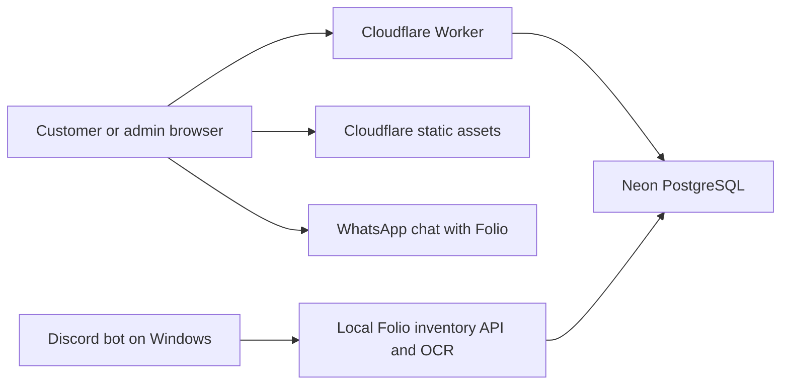

# Folio architecture

Folio is a Next.js bookstore with a storefront, an inventory console, and cash on delivery checkout. Cloudflare Workers hosts the web app, Neon PostgreSQL stores business data, and the Discord inventory bot and photo OCR run on the operator’s Windows PC.

## Frontend and request flow

- **Stack.** Next.js 16 App Router, React 19, TypeScript, and Tailwind CSS. The [root layout](../app/layout.tsx) provides the shared header, footer, typography, and cart provider.
- **Storefront.** `/` renders the searchable [catalog](../components/catalog.tsx). `/books/[slug]` reads the current listing from Neon and returns 404 for an unknown or hidden book. The Worker renders these pages on request.
- **Cart.** React handles quantity and removal controls. The [cart provider](../components/cart-provider.tsx) keeps cart items in browser `localStorage`. The [cart view](../components/cart-view.tsx) calls `/api/books` for current price and stock.
- **Checkout.** `/api/checkout` creates a pending COD request and returns a prefilled WhatsApp link plus a private status token. The shop reviews the message and approves the request from `/admin`. Approval creates the order and deducts available stock in one database transaction. On return and while visible, the browser checks `/api/checkout/status` and removes only the approved copies it still has in the cart. Pending and closed requests preserve cart quantities. See the [COD implementation](../lib/cod-order.ts) and [cart reconciliation](../components/cart-provider.tsx).
- **Admin.** `/admin` labels the credential **Admin access code**. Production verifies the code set during deployment and checks write requests against the configured HTTPS origin. In development, the local admin code takes priority and the Discord PIN is the fallback. Development uses the incoming host for origin checks because Next.js may normalize the request URL to `localhost` even when the browser uses `127.0.0.1`. The inventory and COD APIs validate the signed, HTTP-only session cookie. See [admin authentication](../lib/admin-auth.ts).
- **WhatsApp test.** The admin sender and private checkout test share the fixed Meta template and configured recipient. The checkout option requires an admin session and matches the entered phone against the server configuration. It validates the cart and uses the database rate limiter to claim one delivery attempt per cart and recipient in a 15-minute window, including during concurrent submissions or an ambiguous network timeout. It creates no order or reservation. Public checkout uses the manual WhatsApp link. The [webhook](../app/api/webhooks/whatsapp/route.ts) verifies Meta’s challenge and callback signatures and logs a generic receipt.
- **Stock history.** The edition editor loads the existing stock movement log from the authenticated [stock history API](../app/api/admin/books/stock/route.ts). Changes to available copies in the editor require a reason. The reason is written in the same transaction as the stock change and recorded by the database trigger.
- **Fulfillment.** The admin COD fulfillment section lists orders awaiting packing, shipment, or delivery. Its [orders API](../app/api/admin/cod/orders/route.ts) and the order CLI use the same transition and cancellation logic. Admin writes compare the displayed order stage and subtotal to current values so a stale view cannot pack or cancel an amended order. Shipping requires tracking. Cancellation before dispatch restores available stock in the same transaction.
- **Returns.** A shipped COD order marked refused stays in the fulfillment list while returning. Recording receipt changes the order stage. The operator then enters inspected, resellable quantities on the order lines. Returned and delivered orders can be reopened by order number. Admin restock retries use the displayed returned quantity to identify the same action, and the server caps cumulative restocking at the quantity ordered.

## Cloudflare hosting

The `folio` Worker serves [the live site](https://folio.saadalik11.workers.dev/). The [Wrangler config](../deploy/cloudflare/wrangler.jsonc) points to `.open-next/worker.js` and binds `.open-next/assets` for static files such as JavaScript, CSS, and fonts. Page rendering and API requests execute in the Worker. Open Library cover images load from their source, with Next.js image optimization disabled in the Cloudflare build.

The [build script](../scripts/build-cloudflare.mjs) stages a fresh copy of the app and runs OpenNext to turn the Next.js output into a Workers bundle. Run `npm run deploy:cloudflare` from the repository root in Ubuntu (WSL) to build and invoke Wrangler from that exact staging directory. Wrangler publishes a Worker version. This release path is currently manual. See [deployment setup](../README.md#cloudflare-workers).

The Worker receives `DATABASE_URL`, `ADMIN_PIN`, `ADMIN_SESSION_SECRET`, and `COD_WHATSAPP_NUMBER` as runtime secrets. Its [database adapter](../deploy/cloudflare/db.ts) uses Drizzle and Neon’s WebSocket driver to support interactive transactions. Database migrations run separately from the Worker deployment. See the [OpenNext Cloudflare adapter](https://opennext.js.org/cloudflare) and [Neon serverless driver](https://neon.com/docs/serverless/serverless-driver#use-the-driver-over-websockets).

## Design decisions

| Decision | Reason and operational effect |
| --- | --- |
| Run Next.js and the API in one Worker | The storefront and admin share a deployment, origin, and API. |
| Use Neon as the shared database | The Worker and local inventory API see the same listings, stock, and orders. Stock reservations and order creation use a transaction. |
| Keep Discord and OCR local | The storefront and admin can operate while the PC is off. Discord imports require both the local bot and the inventory API to be running. The Worker build excludes the Discord, SMS, Telegram, and legacy Stripe routes. |
| Track stock per listing and confirm ambiguous matches | Stock commands resolve the listing by ISBN, explicit `slug:`, or an unambiguous match. Discord asks the operator to confirm an edition when listings share a title. Barcode commands use the scanned ISBN. Stock changes continue to be recorded by the database audit trigger. |
| Share the listing price limit between admin and Discord | Both paths use the same Rs 1,000,000 maximum in [store policy](../lib/store-policy.ts) and accept up to two decimal places. |
| Disable Cache Components and partial prefetching in the Worker build | The production build uses request-time rendering for dynamic pages after the earlier rendering failures. Book pages resolve the slug before returning a listing or 404. |
| Use manual WhatsApp confirmation | The customer sends a prefilled reference, and the shop verifies the sender and approves in admin. The handoff uses a link and the operator confirms the order manually. |
| Reconcile the cart after server approval | Browser storage tracks the submitted copy IDs and a signed status token. The WhatsApp message carries the reference alone. The status endpoint returns only the request state, so an unsent message, expiration, or quantities added later cannot clear the cart. Rotating the signing secret invalidates previously issued status tokens. |
| Add verified follow-ups to the existing unshipped COD order | Matching name and address keep the fulfillment destination consistent. Approval reserves the added stock and recalculates one shipping fee in the same transaction. A packed order returns to the packing queue. Follow-up references remain linked to the order after request cleanup so status checks and approval retries resolve correctly. |
| Offer COD nationwide in Pakistan without the Rs 5,000 order cap | The customer enters a city or town and a Pakistani mobile number. The operator reviews the address during WhatsApp approval. Rs 5,000 is the free-shipping threshold. The server guards against amounts that overflow the database's integer columns. |

## Keeping this knowledge base current

Update this page in the same change whenever routes, rendering, data flows, authentication, integrations, or deployment change. For a significant design decision, record what changed, why, and what it means for running the store. Put proposed changes and unresolved issues in the [backlog](../BACKLOG.md). Keep credentials and customer data out of the documentation.
