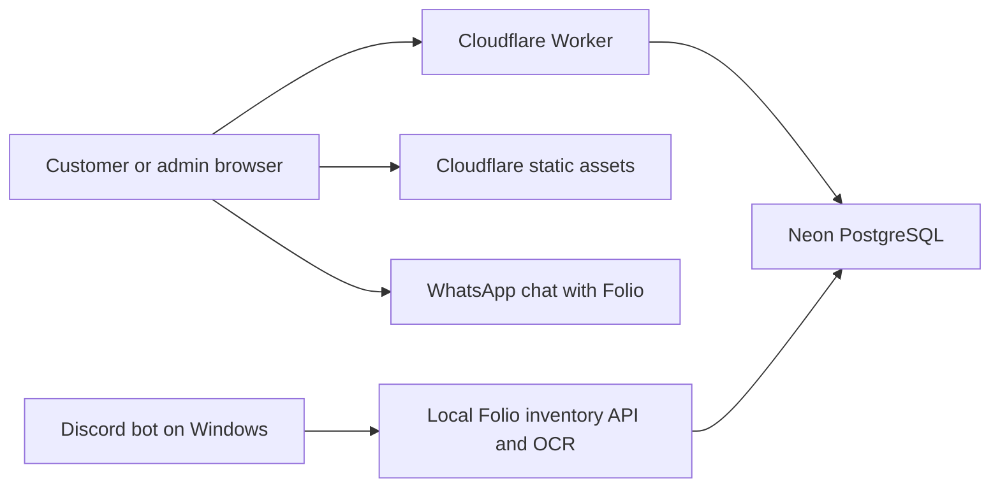

# Folio architecture

## Text-only work review (November 27, 2026)

Service reload subsequently completed through the operator's local:up. Independent supervisor status confirms API/bot/OCR ready, degraded=false and modelLoads=1 with zero restarts in the new session. Updated Gateway UI is loaded; real Discord text-only preview/cancel acceptance remains separate from the isolated tests and saved-photo replay. No real stock import was used for this readiness check.

After operator approval, unresolved scans can offer a title/author-only review without similar artwork. Eligibility requires confidence >=85, bounded visible text height, an exact complete title phrase including numeric tokens, and exact full author or explicitly visible initials. Only adjacent observed words may be joined; missing words, OCR typos and author aliases are not guessed. Independent title evidence and existing visible-initial checks still apply. Candidates use the existing trusted-source allowlist, overall suggestion deadline and at-most-three choices. Matched artwork proposals take precedence for the same work; text-only choices may survive an image-read failure but never a missing catalog match.

The persisted choice carries title-author-only evidence and no ISBN/publisher inference. Both public suggestion and private preview warn that catalog artwork is unmatched and the edition unverified; the catalog image is illustrative. Final confirmation reuses the separate manual-draft path and retains the uploaded photo. The catalog cover is never set as primary and work-only candidates are filtered out at storeEditionCandidates, preventing an admin edition proposal from accidentally adopting them. Owner/channel, original expiry, edit/cancel invalidation and one-time stock claims remain unchanged. No schema migration or Cloudflare release is required. Gateway reload is needed for the updated embed warning; agent stop succeeded but scheduled-task startup failed, leaving operator local:up acceptance pending.

Isolated confirmation/replay tests and edition/manual/retained-photo regressions pass. Saved-OCR/live-catalog replay preserves nineteen earlier automatic paths and produces six correct review cases, leaving three unresolved. The added case is worn Fahrenheit 451 with a correct work-only suggestion; this is not fresh OCR inference or automatic identification. Weak/missing author text and misspelled/incomplete title readings remain manual/barcode cases.

## Open Library cover transport correction (November 27, 2026)

The cover-specific reader follows at most three redirects from an exact Open Library cover-ID URL. Destinations must be HTTPS Internet Archive current l_covers or legacy olcovers paths derived from that same ID, or matching iaNNNNNN.us.archive.org view_archive image requests. Arbitrary hosts, credentials/ports/fragments, mismatched image/archive identities, unexpected queries, redirect loops and non-image responses are rejected. Reads remain bounded to 2 MB and the original caller's deadline. General metadata fetches retain redirect rejection. This repairs actual 302 cover downloads for both publisher lookup and review suggestions without loosening identity/artwork thresholds. Regression tests use the observed current and legacy chains; actual downloads also passed. Newly reachable Kafka work artwork prompted suppression of unsupported catalog-title expansions by token containment, including rearranged titles; visible distinguishing title words preserve alternatives. Saved-OCR replay still gives nineteen preserved automatic paths, five correct review cases and four unresolved photos; alternate artwork coverage is not automatic recognition evidence. See [Open Library cover API](https://openlibrary.org/dev/docs/api/covers).

## Backup retention preview (November 26, 2026)

Operator subsequently approved the eight local removals. Preflight verified all candidate/retained hashes, sizes and directory boundaries; only the approved archive files were removed, preserving five daily points, protected reference/download files and verification sidecars. A private cleanup receipt records the exact removed hashes. No remote objects changed and the planner remains non-destructive.

`backup:retention` provides a local-only review manifest: latest per seven available Toronto backup dates plus four additional older Monday-start weeks, preserving gaps/the latest point rather than expiring everything by age. Authenticated snapshot timestamps drive selection; unknown/manual names, nonregular/symlink paths, failed integrity checks and missing restore reports are protected. The ignored manifest includes hashes to support a later stale-file check. It cannot delete files or access R2. Tests cover date/DST boundaries, duplicate days, sparse/old history, file integrity and non-destructive scanning. Five currently retained daily points passed fresh isolated restore; eight excess local archives await cleanup approval. The single R2 backup remains unchanged; remote lifecycle automation is not enabled. See [retention details](r2-backups.md#retention-policy).

## Off-device R2 archive upload (November 26, 2026)

Scripted S3 acceptance subsequently passed November 26 after the operator saved separate folio-backups-only credentials. The initial token was revoked and replaced with identical scope after credential-saving confusion; photo access was unchanged. backup:upload verified the 520,479-byte archive locally, uploaded the content-hash object, verified its downloaded SHA-256 and restored twenty tables, 158 rows, six photos/archived objects and seven sequences in isolation. The private success receipt is saved beside the local archive. The original manually uploaded object remains as another copy of that same recovery point. This completes credential/transport activation; no backup scheduling or automatic retention deletion follows.

Live dashboard acceptance completed November 26: folio-backups exists with Standard storage and public access disabled. The 520,479-byte November 26 encrypted archive was uploaded manually, downloaded, matched to the original SHA-256 and restored in isolated PGlite (twenty tables, 158 rows, six photos/archived objects, seven sequences). No key or runtime credentials were uploaded. This validates the first off-device recovery point, separately from the scripted S3 transport; command-line credentials remain unconfigured. No automatic backup schedule or retention deletion was enabled.

The opt-in local `backup:upload` command uses a separate private folio-backups bucket and separate S3 credentials, never a storefront Worker binding. It decrypts/restores the selected encrypted archive before upload, uses an immutable SHA-256 key/conditional PUT, then downloads, compares bytes and performs isolated recovery again before saving a local receipt. The recovery key is never sent. A full bounded bucket listing enforces 1 GB/100 objects; a locked local ledger caps attempted requests at 200 per UTC month. No retries, pruning, background schedule or production restore is introduced. These single-workspace safeguards complement the photo allocation but cannot guarantee account-wide free usage. See [setup and recovery](r2-backups.md). Bucket creation and the first manual remote recovery check are complete as recorded above; separate S3 credentials and live scripted-upload acceptance remain pending. Isolated transport bounds/hash/replay tests, type checking and lint pass.

Dracula review acceptance (November 25): operator screenshots and a read-only database check verify the correct author/artwork warning, private preview and persisted cancellation. No test listing or processed import was created. Cancellation results are now persisted; repeat actions on cancelled cover choices return Cancelled/Stock unchanged, including older cancelled rows without a result, rather than an ambiguous already-handled message. No inventory behavior changes.

## Complementary cover clues and author/artwork proposals (November 25, 2026)

Unresolved-cover search now combines up to four prominent fragments with up to four distinct high-confidence fragments (eight total), preserving small author text while preventing promotional text from occupying all slots. It removes leading attribution labels and may join adjacent high-confidence single-word rows; it never repairs spelling or invents missing words. Readings lookups use these bounded queries. Open Library discovery uses two title/author pairings and at most four author searches (six docs each), with up to three discovered title lookups in Readings. Trusted work artwork URLs may be compared directly, carrying no publication ISBN. Images remain limited to twelve, 2 MB each; the total proposal deadline stays twelve seconds. Completed comparisons are retained if another source stalls.

Normal partial-title/author proposals keep existing review thresholds. A separate author/artwork proposal requires the exact visible full author name (at least two meaningful words) and a tighter grayscale/color distance <=0.12. Its title is explicitly labelled as proposed catalog data, not verified OCR, in both the suggestion and final preview. Visible initials prevent incompatible full authors sharing a surname from being offered. When a stronger same-author base-title match exists, unsupported extended/collection titles are suppressed. All proposals still require the existing private preview and explicit final confirmation, create separate zero-price drafts, keep physical ISBN unlinked and leave stock untouched before confirmation.

The final read-only replay of saved OCR/live catalogs retained the nineteen previous automatic results and four earlier correct review cases, added a correct Dracula review case, and left four photos unresolved. Every returned title/author was checked against its label; no wrong-title proposals remained in that run. This measures suggestion availability on the saved corpus, not a new OCR-engine accuracy claim. Tests cover source restrictions, stronger author-only thresholds, incompatible initials, collection alternatives, slow-source partial results and existing owner/expiry/replay/stock boundaries. Gateway restart and real preview/cancel acceptance remain pending; no storefront deployment is needed.

## Admin COD cash reconciliation (November 25, 2026)

The admin fulfillment page exposes the existing CLI cash workflow in two distinct stages: exact customer cash collection after delivery, then net courier payout to Folio with a statement reference. `cod-cash-panel.tsx` displays separate customer/courier statuses, timestamps, payout receipt and the difference from customer payment (not automatically classified as a fee). Delivered cash-due/paid orders without a remittance remain in the active queue. Settled orders leave that queue and remain available by order number. No courier/bank integration or actual transfer is triggered.

The existing authenticated, same-origin `/api/admin/cod/orders` endpoint accepts collected/remitted actions with a decimal PKR string and the displayed fulfillment/subtotal/total/payment/timestamp snapshot. `parseCodCash` converts decimal text to integer paisa without floating rounding; negative/exponent/excess precision/overflow inputs are rejected. Collection must equal the order total. Payout must be between zero and that total, with a bounded nonempty reference. `recordCodEvent` locks the order and checks stale snapshots. Identical web retries return success without rewriting timestamps; changed payout/reference replays fail. CLI calls retain their existing single-event behavior. Collection records paid/collectedAt; remittance records remittedCents/reference/remittedAt. These fields already exist, so no schema migration is needed; neither action changes inventory. Isolated API/order tests cover authorization, validation, stages, stale edits, concurrent/repeated requests, zero payouts, queue transitions and rendered GUI controls. Production release/operator UI review is pending.

Production release completed November 25 as Worker ff63a5b6-3dd6-4128-bc52-930bf581c50d. Public rendering, availability/database reads and unauthenticated admin rejection passed in the operator's release run. A photo-check connection timeout stopped later verification; independent read-only retries passed both R2 image hashes and deployed admin asset checks for the cash forms. No redeployment or authenticated cash writes were needed. November 26 read-only GUI acceptance verified the active awaiting-packing order has no cash-entry form, while fresh number lookup retrieves the completed delivered order's saved collection, payout, reference and difference without submission controls. Existing records rendered legibly at the narrow browser width. No live write or real-world payment verification was performed.

## Windows lifecycle acceptance (November 25, 2026)

The operator completed the requested sleep/wake test and subsequent Windows restart/sign-in test, running only `npm run local:status` after waiting for automatic startup. Both outputs report API, Discord bot and paddle-mobile OCR ready, degraded=false, one model load and zero API/bot/OCR restarts. Startup and resume readiness acceptance is complete; this supersedes historical pending logon checks below. These status checks do not probe Neon or create an inventory import. Local imports continue to require an awake, connected PC.

## Partial OCR suggestions after unresolved recognition (November 25, 2026)

November 26 candidate-budget refinement: words belonging to a candidate's author cannot also count as independent title evidence (for example, The Stories of Ray Bradbury cannot gain title support solely from Ray Bradbury). Author-only candidates may consume at most three of the existing twelve artwork comparisons, preserving capacity for title-supported results arriving from other catalog queries. Existing review thresholds, explicit confirmation and unlinked-ISBN behavior remain unchanged. Focused isolated tests pass; saved-OCR/live-catalog replay retains nineteen earlier automatic paths and five correct review cases, with four unresolved. Visual inspection of those remaining cases found missing author OCR on Mockingbird and different compared catalog jackets on vintage Catcher and both Fahrenheit photos; this is not proof that matching jackets are unavailable from every source. No new automatic recognition claim or production inventory change follows from this refinement.

The successful mobile → Tesseract → crop identification path is unchanged. Only an unresolved scan supplies accumulated OCR lines to `cover-suggestions.ts`. It selects at most four distinct short fragments with confidence >=70 and nontrivial text height, rejects common promotional/imprint text, searches Readings, and makes two bounded Open Library title/author discovery searches with the two strongest fragments in either order. Discovery supplies catalog titles for additional Readings lookups; it does not verify an author expansion or ISBN. There is no paid API requirement. Source discovery is currently limited to Open Library plus Readings; other stores and weak/absent text remain manual/barcode cases.

Proposals require separate fragments supporting title and author, fixed public catalog/image origins, and the existing review-level spatial grayscale/color comparison. At most twelve candidate images (2 MB each) are compared; at most three proposals are returned, within a 12-second suggestion deadline. Failures fall back to the retained-cover/manual response. This review threshold never becomes automatic work identification. A replay from the existing 28-image corpus preserved nineteen previous automatic successes and produced four correctly labelled suggestions, including Kafka, leaving five unresolved. This used saved OCR and live catalogs, not new engine inference; results are private in `.folio-ocr/suggestions-review.json` and can be repeated with `npx tsx scripts/ocr/review-suggestions.ts`.

`suggested-cover.ts` stores proposals in existing `cover_barcode_choices` JSON with the saved-cover owner/channel/expiry and `manualEntryId`. No schema migration is needed. A Review suggestion button requests a private preview of the saved photo alongside the catalog cover; final confirmation reuses the manual retained-cover claim/import flow. It creates a separate zero-price draft with unlinked ISBN, retained photo and unverified edition proposals, never merging by title or ISBN. Suggestions and previews add no stock. Manual editing cancels old proposals; used/expired covers, wrong owners/channels and replays cannot receive another copy. Local Gateway restart is required for the new button handler; Cloudflare storefront deployment is unaffected because local inventory routes are excluded.

The Gateway reload and real Kafka suggestion/preview/cancel acceptance were verified November 25. The proposed title/author matched, private preview returned HTTP 200 and cancellation persisted without a new draft; existing listings #125/#128 remained at stock 1/0. Whole upload handling took 36.6 seconds including all recognition, catalog and storage stages. Live receiving was deliberately not exercised with an extra test copy; isolated confirmation/concurrency tests cover that path.

## Independent listings with a shared ISBN (November 25, 2026)

An ISBN identifies a publication, not a sellable inventory row. Multiple listings can share a checksum-valid canonical ISBN while each listing ID owns its price, quantity, slug, photos, description and edition review. Migration 0017 removes raw/canonical real-ISBN uniqueness, adds a nonunique canonical lookup index, and retains uniqueness for non-ISBN internal import keys. Physical-copy confirmation and stale-save checks remain required; linking an ISBN never transfers stock, merges metadata or changes another listing.

Migration 0017 is applied on Neon. Before/after checksums for books, edition details, photos, orders, order lines and stock audit rows matched; activation changed only schema/migration history. Operator save/persistence acceptance confirmed listings #125/#128 share ISBN 9780805210552 with separate IDs/slugs and unchanged stock (1/0). Cloudflare Worker version 658f5e01-ca21-4bbd-b91c-d95965e981bc deployed November 25, 2026. Operator release output confirms live admin assets include the shared-ISBN policy and listing IDs; storefront/database checks, admin access protection and existing R2 photo checksums pass. Release verification performed no authenticated admin writes.

ISBN-10 and ISBN-13 aliases return every matching listing. Imports serialize on the canonical ISBN and reject ambiguous automatic receiving. Barcode scans with two to five matches use the existing explicit stock-choice confirmation; larger sets require an ID/slug. A waiting retained cover cannot be silently attached to one of several matches. Text inventory commands and the CLI accept `id:<listing ID>` / `slug:<slug>` and reject ambiguous ISBNs. Admin cards/editors expose listing IDs so identical titles can be distinguished. Cart, checkout, fulfillment, photos and audit remain keyed by listing ID. Manual cover import keys stay unique for replay safety. The Cloudflare build omits local inventory channels; its admin must be redeployed for the revised ISBN-linking policy.

Folio is a Next.js bookstore with a storefront, an inventory console, and cash on delivery checkout. Cloudflare Workers hosts the web app, Neon PostgreSQL stores business data, and the Discord inventory bot and photo OCR run on the operator’s Windows PC.

### Manual identification of retained covers

The operator completed the real manual form/preview/confirmation path for Kafka on November 25. It created a separate draft (#128) with one copy while the original published edition (#125) stayed at one. The accidentally confirmed test copy was subsequently corrected by a guarded 1 → 0 admin adjustment with a recorded reason; the draft and photo/history were retained. Live UI acceptance is therefore verified, without treating this test as an additional physical copy.

The admin's matching Readings proposal is evidence of successful catalog/artwork search after title and author are known, not independent OCR success. The saved-cover proposal endpoint supplies stored book.title/book.author and no OCR clues to lookupPublisherCover, which retrieves candidates and compares artwork. Partial-OCR candidate discovery plus visual review may be a future assisted-identification stage; it must remain separate from automatic ISBN/edition verification.

When automatic recognition fails and the photo is retained, the bot offers a title-and-author modal as an alternative to ISBN scanning. Opening the modal has no database/network delay; submitting it calls the authenticated inventory route with the Discord account/channel and saved-cover ID. The server validates one-line bounded fields and checks that the same account/channel still owns an unexpired waiting cover. It queues only a private preview; stock is untouched until Confirm draft. The original retained quantity and expiry remain authoritative, and the preview includes the saved photo. Editing creates a new confirmation and cancels older pending previews so old buttons cannot apply newly edited text. Private previews use deferred interaction updates; public existing barcode/title confirmations retain their previous reply behavior.

Manual confirmations reuse `cover_barcode_choices` JSON metadata and the established retained-cover claim/promotion/import transaction. `manualEntryId` identifies the source cover, yielding a unique `manual-entry-…` inventory key rather than inferring ISBN or catalog work identity. A confirmed request creates a separate zero-price draft with the canonical saved photo; it never merges by title/author with an existing edition. A matching title/author is flagged in the preview, directing the operator to ISBN entry when receiving into that edition is intended. Public ISBN rendering already shows these manual keys as Not verified. Publisher, translator and edition metadata remain unset. Cancellation adds no stock; expiry retains the existing private-object cleanup. Edits/confirmations share a per-cover advisory lock, and used-cover checks plus existing import source IDs protect concurrent/replayed confirmations. A manual request cannot use Barcode only to bypass its saved-cover confirmation.

No new tables or migration are required. Isolated database/object-store tests exercise owner/channel isolation, validation, preview-only submission, edit invalidation, cancellation/expiry, replay/racing confirmations, retained quantity, existing-edition protection and temporary-versus-permanent photo cleanup. The Discord modal serializer/prefill and authenticated form endpoint are tested without sending messages. The change requires a local bot reload (`npm run local:restart`); operator UI acceptance is pending. A read-only Kafka crop probe still failed the cursive word, so this is an explicit operator correction path rather than a claimed automatic recognition fix.

### Persistent local mobile OCR integration

A fresh operator Discord upload passed the real import path on November 24: mobile-stage match, normal bot reply, one processed attachment, and a persisted Blood Meridian / Cormac McCarthy draft (#127, stock 1) with its uploaded photo referenced in R2. No pending confirmation remained. The API's complete request took 24.7 seconds; that includes catalog, publisher, image storage and database work and is not standalone model inference latency. Verification was read-only and did not replay the upload. This completes initial live mobile-path acceptance for one cover, not general OCR accuracy or fallback coverage. Physical edition verification, price and publication remain operator review steps; Kafka and other unresolved covers still follow the barcode/manual path.

Activation completed on November 24: the operator supplied the final managed-worker PASS after the model smoke checks, and the activation marker plus managed worker ready log at 13:12:21 UTC were independently verified. The earlier degraded/readiness-false status in the command output was a startup snapshot taken before model initialization finished. Mobile-first recognition is now enabled in the managed local API; production Cloudflare hosting was unchanged. A fresh operator Discord cover upload remains the end-to-end acceptance step. Activation itself replayed no photos and changed no stock. Earlier pending-activation notes below are historical.

The corrected real-model smoke check passed in the operator's WSL session. The next activation step exposed a stale supervisor-control endpoint: its owner PID no longer existed and neither the control endpoint nor port 3000 was listening. `local:stop` now handles already-stopped services idempotently, deleting unchanged stale control state only after refusal/missing-file errors and proof the saved PID is dead. It never treats permission denial, a timeout or a live/starting owner as stale. Owner PID/nonce is included in new control records; replacement records are protected from cleanup races. A successful stop also waits until its control and lock state have been released before returning, preventing activation from mistaking an old supervisor's acknowledgement for completed shutdown. The actual stale record was recovered without terminating processes. Real model preflight is verified; final managed-worker startup/activation remains pending the operator rerun.

The first operator activation attempt loaded the persistent worker and passed two detector/pipeline scans but rejected the direct-recognition text before enabling the marker. The smoke fixture now gives the detector its full canvas and the recognition-only model a tightly cropped line; a geometry regression verifies foreground occupancy rather than claiming model accuracy. Private `ocr-smoke-check.json` stores only synthetic check results and direct-line dimensions/confidence, never uploaded book text. The installed PaddleX flag is `PADDLE_PDX_DISABLE_MODEL_SOURCE_CHECK`; correcting it avoids the unnecessary startup host-connectivity check when cached models are used. Actual successful model preflight/activation still requires the operator retry. Failure cleanup was verified: no activation marker or worker state remained.

Mobile-first recognition is implemented behind a local activation marker, `.folio-local/ocr-enabled`. Without the marker, managed services continue using Tesseract. `ocr:enable` first warms an isolated persistent worker, performs repeated synthetic mobile scans and a direct-line scan, checks readiness/one primary model initialization, stops the preflight worker, then restarts the existing local supervisor with mobile enabled. It reuses the isolated WSL Python environment and cached mobile models from the trial. `ocr:check` performs only the smoke check; `ocr:disable` removes the marker and restarts with Tesseract. Activation cannot be completed by this agent because Windows denies WSL execution; actual worker startup and operator acceptance remain pending. No Cloudflare changes are needed for this local service.

The supervisor launches a Node bridge child, which owns one WSL Python process. Python loads the mobile detector/recognizer once, then lazily retains a direct-line recognizer for crop fallback. Model settings match the trial: detector max960, CPU/two threads, batch one, orientation/unwarping off. Node listens only on 127.0.0.1 with an ephemeral port and random bearer token in private runtime state; the API reads that state and validates bounded responses. Requests contain prepared image bytes, never database credentials or catalog access. Python accepts private stdio requests, keeps images in memory and exits on parent-pipe EOF. The bridge admits one job, rejects busy/oversize/unready requests, checks a 27-second response deadline and restarts on worker failure; Python has a 25-second inference watchdog. Tokens and image bodies are not logged. Supervisor heartbeat/restart and model readiness appear in local status/health, with degraded mode retaining Tesseract availability.

`recognizeCover` prepares a maximum-1600px image and runs mobile catalog matching first. A successful match stops the chain. Worker unavailability uses Tesseract; a genuine no-match uses initial+focused Tesseract output, then at most eight crop/line views if mobile was available. A catalog exception does not trigger more OCR in the mobile policy. The whole recognition stage has a 40-second deadline and one-cover admission guard; its late work can only return metadata, never write inventory. The existing route performs authorized stock/title-choice/photo writes only after an accepted result, preserving replay protection and edition isolation. Unresolved/timed-out covers use the existing retention/barcode flow. Barcode scans still precede all cover OCR. The legacy Tesseract-only route retains its existing first-pass/focused catalog retry. Stage/matched status is logged without cover text or image contents.

Production and benchmark share crop preparation/row-order code in `lib/cover-geometry.ts`; all 160 frozen crop hashes matched after extraction. HTTP auth/busy/size/readiness tests, policy early-exit/outage/cancellation tests, and an isolated mobile HTTP → authenticated import → persisted draft/photo test pass, including duplicate-message and catalog-outage stock protection. Existing photo-import/title-choice and supervisor lifecycle tests pass. These checks validate integration logic; they do not replace actual WSL model smoke testing or fresh Discord acceptance, and do not establish live end-to-end latency.

### Local cover recognition: November 24 correction

The refreshed staged-policy report completed at 11:37 UTC: 19/28 exact title+author matches, zero returned mismatches and no policy catalog outages. It retains all 17 mobile successes, adds Odyssey through Tesseract and Wuthering Heights through crops; uploads 5/6, web photos 12/16, clean covers 2/6. Seventeen cases stop at mobile, one at Tesseract and ten reach crops. Median summed inference cost is 1.730s using cached stage measurements; this excludes model startup, catalog reads and Discord latency and is not a live service benchmark. The all-at-once crop engine remains at 17 exact successes with a noncanonical Odyssey/title mismatch, so it is not a suitable unconditional replacement. Kafka and eight other policy cases remain unresolved. The author-appended Fahrenheit label is fixed by a captured regression, but live candidate ambiguity still gives no match for that geometry case. Future reporting memoizes identical OCR lookups within a run, including misses/outages, to avoid duplicate queries. All integration tests pass in isolation. This establishes a promising policy on the curated development corpus, not a production engine switch. A persistent local mobile worker, bounded fallback execution and explicit operator review still require implementation/acceptance; live bot remains Tesseract.

The initial geometry run completed all 28 cases: row ordering alone remained at 17 correct labels, and combining all crop readings also gave 17, with two returned-label/work-record mismatches. Additional evidence regressed one previously successful Durant cover. Median combined OCR was 3.649s, initialization 15.668s and peak Python RSS 734.6MiB. It recovered Odyssey lettering but selected a noncanonical same-work record after mixing evidence; Kafka's cursive title remains unresolved. These results motivated a benchmark-only staged policy: retain a mobile match, then try Tesseract on no-match, then crop evidence. A catalog exception stops evaluation as an outage instead of triggering more OCR. Expected labels are used only for scoring, never stage selection. The current crop-order correction separates smaller text above a larger title, and the cover formatter now strips an appended verified author only when the remaining edition label exactly equals the canonical work title. Original geometry reports are retained under `*-geometry-initial.json`; the refreshed five-engine policy report is pending. The live OCR engine remains Tesseract.

The next geometry experiment is benchmark-only: generate two overlapping 60%-height photo crops and up to six full-width row crops based on prominent mobile OCR regions, bypassing the detector for the latter with the same English mobile recognizer. Crop selection never reads expected labels; each view has an input hash and original-image transform. Detector-crop boxes map back exactly; direct-line results retain their source-row anchor because recognition alone supplies no geometry. Overlapping regions are grouped only when every member substantially overlaps vertically, then read left-to-right; raw coordinates remain separate. This addresses tall initials and fragmented rows without fuzzy title guessing. Four-engine reporting separates Tesseract, unchanged mobile, mobile with only row ordering, and mobile with crop passes. Crop inference runs on all 28 cases to measure regressions and additional cost; this is not a deployed fallback policy. Outputs use the geometry suffix and retain earlier trials. Live engine remains Tesseract, and runtime measurement awaits operator WSL execution.

The operator completed the controlled server-recognizer comparison on the identical 28-photo manifest. Fresh current-matcher results were 17/28 exact title+author matches for mobile and 17/28 for server recognition, without Paddle catalog outages. Each cohort tied (uploads 4/6, real web photos 11/16, clean covers 2/6), but individual successes changed: server gained two photos and lost two, with fused author tokens causing regressions. Both still fail Kafka and Odyssey. Server additionally selected correct Fahrenheit work OL103123W with an author-appended edition title, recorded as a returned-label mismatch rather than a different-book match. This remains an open formatter regression. Median measured OCR increased 1.274s → 2.431s, startup 13.249s → 16.566s, and peak Python RSS 762.4 → 855.4MiB. Tesseract had 6 correct results and one catalog outage; its two-pass timing is not normal first-pass bot latency. Results support keeping mobile as the leading trial candidate, not activating the heavier model. Text detection/crops and reading order need separate evaluation; the detector did not change in this comparison. These are curated development-set results, not a general accuracy guarantee. Reports: .folio-ocr/comparison-stronger.json and group-summary-stronger.json. No bot engine or production deployment changed.

The next isolated trial changes only PP-OCRv5 mobile English recognition to PP-OCRv5 server recognition; mobile detection remains capped at 960 with batch one and two CPU threads. `ocr:stronger` validates frozen photo hashes and complete saved baselines before invoking WSL, reuses the Python environment and leaves original reports untouched. It measures initialization/peak RSS and records incomplete output before model initialization so startup failures cannot masquerade as a prior success. A separate three-engine report applies the current matcher to saved Tesseract/mobile OCR plus new stronger OCR, with throttled live search/author reads. This provides a controlled recognizer comparison, not a detector improvement or an automatic engine rollout. Execution/results remain pending the operator's WSL-capable terminal.

The subsequent matcher correction separates visible work-title evidence from edition labels. It strips only verified author attributions, known format qualifiers and author-named collection wrappers; arbitrary subtitles/sequels are retained. Anthologies and adaptations require their full identifying labels, and author-only evidence is rejected. Two distinctive words of at least four characters each can now establish a stacked title, still in order and with visible author evidence. Near-equal duplicate records remain ambiguous; dominance requires 2× edition count for the same primary author ID, 3× otherwise. A much weaker abbreviated-author duplicate may be ignored only when its title agrees and the stronger fully supported author contains its non-initial name parts. This does not establish a new author alias.

Captured-response replay improved Paddle matching from 13 to 17 correct among 27 cases with fully recorded requests; Tesseract remains 5/27. Both captured-only cohorts have zero returned-title mismatches after the change. One additional case per engine uses a separately labelled Homer author fixture: Odyssey is corrected for Tesseract, while Paddle's Odissey transcription still fails. Seven recorded regression cases plus negative tests cover title labels, translations, collections, adaptations, author identity and ambiguity. `ocr:replay` intercepts every fetch, requires exact recorded queries and labels absent responses; it neither repeats OCR nor mutates inventory. The original measured report is preserved. These are improvements on a curated development set, not held-out OCR accuracy or a live catalog check. Tesseract remains the active engine; no Worker deployment was performed.

The expanded November 24 evaluation covered 28 distinct images / 19 titles. Correct catalog title+author counts were Tesseract 3/6 vs Paddle mobile 4/6 on saved uploads/variants, 1/16 vs 8/16 on real web photos, and 1/6 vs 1/6 on clean covers (5/28 vs 13/28 overall). Each had one returned-label mismatch, with no catalog outages. The mismatches were an illustrated Odyssey label/work and a Dune audiobook edition title; they should not be described as two unrelated-title errors. At least three Paddle no-match cases had complete expected title/author words, demonstrating that catalog matching is a distinct bottleneck. The trial therefore supports continued Paddle evaluation, not automatic activation. Median measured OCR times were 2.611s for always-two-pass Tesseract and 1.274s for Paddle, with 13.249s model initialization separately and 762.4MiB peak Python process RSS. These timings exclude overall Discord/catalog response latency. Detailed reviewed evidence remains in `.folio-ocr/evaluation.txt` and the private JSON outputs. This is a curated development set with repeated titles, not a held-out general accuracy measurement.

The OCR benchmark now distinguishes saved operator photos, real-world web photo candidates, and clean catalog baselines. `ocr:expand` reads listing-photo references and photo bytes without calling inventory routes, tests the saved-photo cohort first, then retrieves a bounded curated web manifest. Photos/labels/source links/contact sheets remain under ignored `.folio-ocr/`. Proposed source labels require visual verification before contributing to verified counts. Duplicate normalized pixels are skipped, repeated books are not treated as independent titles, and groups are reported separately. Validated seed inputs are frozen copies rather than the mutable latest Discord download. Normal catalog requests in the benchmark are throttled to 1.1-second spacing. No photo is uploaded to an OCR provider or published as product artwork by corpus collection.

Catalog tracing explained the trial's Little Prince false match: splitting an edition label at its colon made the visible author name look like an exact title for another book by that author. Cover matching now disallows author-only title evidence, including resolved author aliases. An eponymous title therefore needs other evidence/barcode review rather than author-only automatic identification. OCR merging also compares text spans before replacing a weaker row, so a confident two-letter fragment cannot erase a complete title line. Recorded catalog-response regression tests cover the misleading Letters to Mother record and the correct Little Prince work; these checks do not mutate existing listings.

The first successful mobile Paddle trial completed on November 24: all three images (two books) resolved to the expected title/author, per-image OCR took approximately 1.1–2.3s, and peak Python process RSS was 680.5MiB. Model initialization took 27.016s separately; any production local integration should use a long-running worker. These small-sample observations do not establish general accuracy or end-to-end speed. The same comparison exposed a Tesseract-path Little Prince result named Lettres A Sa Mere despite 100% title/author word coverage. Catalog tracing was added to distinguish recognition evidence from work/edition/title selection errors. No engine switch or inventory mutation is part of this read-only trial.

The OCR replacement trial initially used server models and failed attempting an approximately 9.4GiB allocation on the operator's machine. Its next candidate uses PP-OCRv5 mobile detection/English recognition with a 960-pixel detector maximum side, batch size one and two CPU threads; optional orientation models are disabled. This is an experimental workload reduction, not a measured memory guarantee. The report records exact configuration and completion status, and the comparison rejects partial runs. The normal bot remains on Tesseract pending successful measurement and acceptance.

An independent replacement experiment is available through `npm run ocr:trial`; see `scripts/ocr/README.md`. Windows Node prepares bounded/hash-identified inputs and the Tesseract baseline; an isolated WSL Python 3.12 environment runs pinned PaddleOCR/PaddlePaddle on CPU. The same catalog matcher evaluates both engines without invoking inventory endpoints. Raw OCR, labels, model startup/per-image times and catalog outcomes remain private in `.folio-ocr/`, which is excluded from Git and normal application backups. Benchmark photos persist independently of temporary Discord-cover expiry. Cold-start timing and uncalibrated confidence/word-coverage limitations are reported explicitly. This experiment has no effect on the production Worker or current local bot engine. A broader labelled dataset and operator acceptance are required before an engine migration.

Follow-up verification used the actual Discord attachment, not just the clipboard crop. Tall connected border components are removed from the adaptive mask before row detection, and an additional view isolates dominant-height lettering from small conjunctions and decorative rules. The untouched mixed-size view remains available. Overlapping one-character variants prefer the stronger reading; this does not introduce fuzzy acceptance of catalog titles. Both photo variants passed OCR, and the operator-run read-only diagnostic verified the actual attachment against live Open Library work OL1073943W with Will Durant as author. No import or stock mutation occurred. The sanitized OCR output is a durable test fixture; the attachment and diagnostic report remain private/ignored. Operator acceptance completed November 24 at 02:19 Toronto time: the normal Discord response confirmed one received copy, draft stock 1 and the uploaded cover saved as the second listing photo. This was a normal operator upload, not a diagnostic replay; physical edition review remains separate.

Large serif lettering and long stacked titles need layout recovery before catalog matching. The focused OCR pass now detects text rows from local contrast against a blurred background, reads bounded padded line crops at normal character sizes, and includes a second view for rows mixing small words with large capitals. Existing full-page and fixed-band views remain available for other layouts and cover-edge text. Two concurrent scans, a 15-second hard deadline and a shorter optional-pass budget bound local work. Coordinates are image-relative across passes; stronger overlapping readings replace weak duplicates, without raising confidence in unrelated text.

Catalog queries combine up to eight confident lines and use AND word searches so omitted conjunctions need not defeat discovery. Search discovery alone never verifies a book: a long-title fallback requires at least three distinctive words, all present in order, plus the existing visible-author check. Only exact concatenations of catalog words can repair missing OCR spaces. A work match supplies neither a physical ISBN nor edition artwork. Catalog outages and OCR time limits now have separate bot explanations while retaining the same private-photo expiry and barcode-confirmation workflow.

The reported Durant photo passed real OCR and mocked-catalog regression testing; this does not establish live catalog availability or completed Discord acceptance. Run `npx tsx scripts/test-cover-recognition.ts` for matching safety tests, or append the private photo path to repeat OCR without database writes. These modules run in the local Next development API and reload on the next request; no Worker release or Discord Gateway restart is required. The agent's November 24 external DNS and local-control restrictions prevent independent live acceptance, which was subsequently completed through operator-assisted diagnostics and the normal Discord import recorded above.

## Frontend and request flow

The local database cache tracks the configured database URL and transport so
a configuration change replaces the previous connection. Failed initialization
can be retried. Neon uses the HTTP Drizzle adapter for ordinary statements and
the serverless adapter with Node `ws` for interactive transactions. The database
object delegates its transaction method to that WebSocket adapter so nested
savepoints and existing callers retain transactional behavior. Database HTTP
uses Undici directly, independently of Next.js rendering fetch hooks. Its transaction
pool allows three connections. This avoids direct
PostgreSQL connection timeouts observed locally and retains transactional
inventory and order operations. Other PostgreSQL hosts use `postgres`. Pools
use a 20-second connection timeout for Neon and 10 seconds for other PostgreSQL
hosts, and close after 20 idle seconds. Catalog page results include their total
count in the same read, with one retry after a failed connection. Empty pages
load a separate count to preserve pagination. Book details and uploaded photo
reads also retry one network failure. SQL validation failures are surfaced
immediately, and writes and transactions are never automatically replayed.
Each database HTTP request has a 10-second deadline so a stalled connection
cannot leave the loading fallback waiting indefinitely.
Development keeps one cart context across hot reloads to preserve the provider
identity used by streamed book controls.

- **Stack.** Next.js 16 App Router, React 19, TypeScript, and Tailwind CSS. The [root layout](../app/layout.tsx) provides the shared header, footer, typography, and cart provider.
- **Storefront.** `/` renders the searchable [catalog](../components/catalog.tsx). `/books/[slug]` reads the current listing from Neon and returns 404 for an unknown or hidden book. The Worker renders these pages on request.
- **Uploaded covers.** Identified front-cover imports save a resized, auto-oriented WebP as the listing's second image; catalog artwork stays first. One photo per listing is referenced atomically with the stock import, including deferred title choices and duplicate deliveries. The original implementation stores base64 in `book_photos`. The November 23 R2 release adds private object references, guarded local uploads, native Worker reads and verified database fallback. Existing originals are preserved. Enable local `PHOTO_STORAGE=r2` only after the new Worker passes deployment checks. The photo endpoint still serves published, priced listings only. See the R2 cutover section for release status and migrations 0014–0015.
- **Cover recognition.** The focused OCR fallback adds single-line reads with horizontal expansion for prominent, condensed lettering and retains individually confident words when surrounding artwork lowers the line score. It combines the initial and focused text so a successful author read is retained. Cover matching can verify an author against alternate names from that same Open Library author record, allowing an English name such as Homer to match the catalog's Greek name. Wrapped title phrases use their largest text height. Duplicate-work comparisons tolerate a leading article while retaining the existing edition-count dominance check. These changes recovered The Odyssey from the November 20 upload.
- **Discord availability.** The local inventory server and the Discord bot must both run for uploads and title buttons to receive replies. The bot sends a typing indicator while processing photos and replies when the inventory connection fails. After an ambiguous timeout, the operator checks stock before submitting a new message because Discord gives each resend a new identifier.
- **Title-button status.** The bot immediately replies with an explicit saving status. Once the API returns a completed title choice, it replaces the original prompt with the result and removes its buttons, then updates the private reply. Updating the public result independently lets the saved outcome remain visible if the private interaction response fails. Discord REST calls use a 10-second timeout and one retry.
- **Cart.** React handles quantity and removal controls. The [cart provider](../components/cart-provider.tsx) keeps cart items in browser `localStorage`. The [cart view](../components/cart-view.tsx) calls `/api/books` for current price and stock.
- **Checkout.** `/api/checkout` creates a pending COD request and returns a prefilled WhatsApp link plus a private status token. The shop reviews the message and approves the request from `/admin`. Approval creates the order and deducts available stock in one database transaction. On return and while visible, the browser checks `/api/checkout/status` and removes only the approved copies it still has in the cart. Pending and closed requests preserve cart quantities. See the [COD implementation](../lib/cod-order.ts) and [cart reconciliation](../components/cart-provider.tsx).
- **Admin.** `/admin` labels the credential **Admin access code**. Production verifies the code set during deployment and checks write requests against the configured HTTPS origin. In development, the local admin code takes priority and the Discord PIN is the fallback. Development uses the incoming host for origin checks because Next.js may normalize the request URL to `localhost` even when the browser uses `127.0.0.1`. The inventory and COD APIs validate the signed, HTTP-only session cookie. See [admin authentication](../lib/admin-auth.ts).
- **WhatsApp test.** The admin sender and private checkout test share the fixed Meta template and configured recipient. The checkout option requires an admin session and matches the entered phone against the server configuration. It validates the cart and uses the database rate limiter to claim one delivery attempt per cart and recipient in a 15-minute window, including during concurrent submissions or an ambiguous network timeout. It creates no order or reservation. Public checkout uses the manual WhatsApp link. The [webhook](../app/api/webhooks/whatsapp/route.ts) verifies Meta’s challenge and callback signatures and logs a generic receipt.
- **Stock history.** The edition editor loads the existing stock movement log from the authenticated [stock history API](../app/api/admin/books/stock/route.ts). Changes to available copies in the editor require a reason. The reason is written in the same transaction as the stock change and recorded by the database trigger.
- **Fulfillment.** The admin COD fulfillment section lists orders awaiting packing, shipment, or delivery. Its [orders API](../app/api/admin/cod/orders/route.ts) and the order CLI use the same transition and cancellation logic. Admin writes compare the displayed order stage and subtotal to current values so a stale view cannot pack or cancel an amended order. Shipping requires tracking. Cancellation before dispatch restores available stock in the same transaction.
- **Returns.** A shipped COD order marked refused stays in the fulfillment list while returning. Recording receipt changes the order stage. The operator then enters inspected, resellable quantities on the order lines. Returned and delivered orders can be reopened by order number. Admin restock retries use the displayed returned quantity to identify the same action, and the server caps cumulative restocking at the quantity ordered.

## Cloudflare hosting

The `folio` Worker serves [the live site](https://folio.saadalik11.workers.dev/). The [Wrangler config](../deploy/cloudflare/wrangler.jsonc) points to `.open-next/worker.js` and binds `.open-next/assets` for static files such as JavaScript, CSS, and fonts. Page rendering and API requests execute in the Worker. Open Library cover images load from their source, with Next.js image optimization disabled in the Cloudflare build.

The [build script](../scripts/build-cloudflare.mjs) stages a fresh copy of the app and runs OpenNext to turn the Next.js output into a Workers bundle. Run `npm run deploy:cloudflare` from the repository root in Ubuntu (WSL) to build and invoke Wrangler from that exact staging directory. Wrangler publishes a Worker version. This release path is currently manual. See [deployment setup](../README.md#cloudflare-workers).

The Worker receives `DATABASE_URL`, `ADMIN_PIN`, `ADMIN_SESSION_SECRET`, and `COD_WHATSAPP_NUMBER` as runtime secrets. Its [database adapter](../deploy/cloudflare/db.ts) uses Drizzle and Neon’s WebSocket driver to support interactive transactions. Database migrations run separately from the Worker deployment. See the [OpenNext Cloudflare adapter](https://opennext.js.org/cloudflare) and [Neon serverless driver](https://neon.com/docs/serverless/serverless-driver#use-the-driver-over-websockets).

## Application backup and isolated recovery

`scripts/backup.ts` creates encrypted, compressed Folio application bundles using
the existing database transport. Snapshot reads run in one repeatable-read,
read-only transaction and include all public tables, uploaded cover data,
applied migration sources, and sequence state. Each table has a canonical row
checksum. The recovery SQL reconstructs an empty database from those migrations,
loads parent tables before dependent rows with user audit triggers temporarily
disabled, reenables the triggers, and restores sequence values without reusing
numbers consumed by deleted test records. It refuses a nonempty public schema.

Verification reconstructs the original snapshot in fresh in-memory PGlite, checks
full row checksums, columns and sequence values, then tests the photo hydration
statements included in recovery SQL. It never accepts a production restore target.
Referenced and ready R2 objects are archived as encrypted image bytes with their
content-addressed keys, not just URLs. Recovery SQL materializes those bytes into
listing rows and title-choice metadata so recovery does not depend on R2 access.
Backups download objects after the consistent database snapshot; immutable keys
and checksums bind them to that snapshot. R2 usage-budget accounting writes occur
outside the snapshot; business data is read only.
AES-256-GCM authenticates the archive; bad keys and modified ciphertext fail
before any SQL is executed. The key and archives are excluded from Git. SQL
export requires `--allow-plaintext` because the resulting recovery file contains
private customer data. Keep off-device archive and key copies separately.

This provides a recovery path while native PostgreSQL clients are unavailable
on the operator's PC. It covers Folio's migration-managed public schema, not
roles, account configuration, arbitrary extensions, non-public schemas, or
Cloudflare runtime secrets. The exporter refuses source application relations
over 64 MiB and external photo payloads over 64 MiB; total portable archive JSON
is limited to 128 MiB. Use a dedicated object backup before reaching that photo
limit; `pg_dump` alone does not preserve R2 object bytes. Native unpooled `pg_dump`
is the documented path for larger or
independently managed databases. A fresh-target recovery and a verified cutover
are the rollback procedure; the tool does not overwrite production or reverse
individual migrations. Account-specific Neon retention, off-device copies, and
backup scheduling remain operational follow-ups in the backlog.

On November 21, the first live application backup restored successfully into
isolated PGlite: 15 tables, 106 rows, two uploaded photos, and seven sequences
matched. Source Postgres was 18.7 and the restore engine was 18.6. The exact
generated recovery SQL was reverified against the saved encrypted archive after
implementation. No plaintext recovery file was exported and production was
read only. Tests also cover authenticated encryption failure, nonempty-target
refusal, pending-migration exclusion, schema drift, and sequence gaps. The
archive and local key still need separate off-device storage, and the Neon
project's configured history window has not been inspected. A daily reminder
was subsequently configured for 9 PM America/Toronto, prompting the operator
to run the backup command manually. It does not execute backups or resume
other paused backlog work. Off-device storage remains deferred.

## Design decisions

| Decision | Reason and operational effect |
| --- | --- |
| Run Next.js and the API in one Worker | The storefront and admin share a deployment, origin, and API. |
| Use Neon as the shared database | The Worker and local inventory API see the same listings, stock, and orders. Stock reservations and order creation use a transaction. |
| Keep Discord and OCR local | The storefront and admin can operate while the PC is off. Discord imports require both the local bot and the inventory API to be running. The Worker build excludes the Discord, SMS, Telegram, and legacy Stripe routes. |
| Track stock per listing and confirm ambiguous matches | Stock commands resolve the listing by ISBN, explicit `slug:`, or an unambiguous match. Discord asks the operator to confirm an edition when listings share a title. Barcode commands use the scanned ISBN. Stock changes continue to be recorded by the database audit trigger. |
| Share the listing price limit between admin and Discord | Both paths use the same Rs 1,000,000 maximum in [store policy](../lib/store-policy.ts) and accept up to two decimal places. |
| Disable Cache Components and partial prefetching in both builds | Database-backed pages use request-time rendering locally and in production, avoiding staged rendering that can leave the catalog fallback unresolved. Book pages resolve the slug before returning a listing or 404. |
| Use manual WhatsApp confirmation | The customer sends a prefilled reference, and the shop verifies the sender and approves in admin. The handoff uses a link and the operator confirms the order manually. |
| Reconcile the cart after server approval | Browser storage tracks the submitted copy IDs and a signed status token. The WhatsApp message carries the reference alone. The status endpoint returns only the request state, so an unsent message, expiration, or quantities added later cannot clear the cart. Rotating the signing secret invalidates previously issued status tokens. |
| Add verified follow-ups to the existing unshipped COD order | Matching name and address keep the fulfillment destination consistent. Approval reserves the added stock and recalculates one shipping fee in the same transaction. A packed order returns to the packing queue. Follow-up references remain linked to the order after request cleanup so status checks and approval retries resolve correctly. |
| Offer COD nationwide in Pakistan without the Rs 5,000 order cap | The customer enters a city or town and a Pakistani mobile number. The operator reviews the address during WhatsApp approval. Rs 5,000 is the free-shipping threshold. The server guards against amounts that overflow the database's integer columns. |

## Keeping this knowledge base current

### R2 billing controls

The operator activated R2 and configured account-wide $1 warning and $5 urgent
budget email alerts on November 23, alongside Cloudflare's auto-created $10 alert.
The screenshot shows one recipient each and zero spend, but labels the period
Dec 2026; billing-period coverage and email delivery remain unverified. These
alerts do not stop R2 usage or cap its bill, and are separate from free-tier
resource thresholds. The copy and reference preparation status is recorded below.

### R2 photo copy stage (November 23)

The destination is the private Standard-class bucket `folio-photos`. The operator
created it and configured bucket-scoped credentials in ignored local settings.
An encrypted pre-migration backup created at 12:15 UTC on November 23 passed its
isolated restore check: 16 tables, 113 rows, two photos and seven sequences.
Migration 0014 was then applied to the shared database. Both listing photos
(two unique objects, 184,618 bytes total) were copied and downloaded for SHA-256
verification. A separate `--verify` run passed for both reserved objects.
Before/after record counts and checksums confirmed the original books, orders,
order lines, returns, uploaded photos and stock history unchanged. No Neon
photo bytes were deleted; Worker serving and inventory imports still use Neon.

`npm run photos:migrate -- --plan` reads the saved listing photos without writing.
The November 23 plan found two unique photos totaling 184,618 decoded bytes.
With bucket-scoped Object Read & Write credentials in local environment variables
and migration 0014 applied, `--copy` reserves capacity, copies sequentially, and verifies each downloaded copy
by SHA-256. It never removes or changes the original `book_photos` rows.
`--verify` checks all reserved objects, including uncertain prior uploads.
The existing storefront URL and authenticated local import continue using Neon.
The R2-enabled Worker release and local import activation status are recorded below.
Neon original reclamation and historical title-choice cleanup remain pending until
production serving and a new upload are verified.

The fixed copy policy is 512 KiB per optimized WebP, 8,000,000,000 total tracked
bytes, and 10,000 PUT attempts per UTC calendar month. A transaction-scoped global
advisory lock reserves bytes and one attempt before external work. Content-addressed
keys deduplicate identical permanent images. Reservations survive failure/crashes;
permanent reservations are not released automatically. Temporary reservations
are released only after confirmed cleanup deletion. Repeat copies refuse unresolved objects until a
checksum verification succeeds. Requests use one PUT with no automatic retries,
a create-only condition, private signed S3 access, bounded reads and deadlines.
Ready objects are skipped by `--copy`; run `--verify` before any future cutover.

These are application controls for this tool, database ledger and single bucket,
not an account spending stop. Direct dashboard/API uploads, other applications,
other buckets and object retention outside this ledger remain outside the
limit. Keep the ledger and credentials tied to the same bucket/account; never
reset the ledger or switch destinations to bypass an unresolved upload. The
8 GB ceiling intentionally leaves headroom, but free-tier eligibility and billing
periods still require account review. No continuous quota polling was added.

### R2 cutover (November 23; production deployed)

Migration 0015 adds nullable `book_photos.object_key` and a monthly read counter.
The pre-migration encrypted backup restored successfully with 18 tables and both
checksum-matched object originals. Both existing photos were then freshly verified
and linked to their R2 keys without deleting their database bytes. Before/after
checksums confirmed original books, orders, lines, returns, stock history and
inline photo bytes unchanged. Direct local R2 reads matched both originals.
The subsequent `folio-2026-11-23T13-14-38.247Z-625e07.foliobackup` passed restore:
18 tables, 118 rows, two photos, two archived R2 objects and seven sequences.

The Cloudflare build replaces `lib/photo-store.ts` with the native binding adapter
and binds `PHOTO_BUCKET` to private `folio-photos`. S3 keys stay local; the Worker
does not need them. The same published/priced database gate precedes object access,
and both transports verify the object content hash. The existing URL and no-store
policy remain. Missing/corrupt/unavailable R2 reads use a preserved inline original;
without one they return 503, rather than exposing another image. The diagnostic
`X-Folio-Photo-Storage` header reports the actual source, allowing deployment checks
to reject a silent fallback. Draft requests cannot consume an R2 read.

All controlled R2 downloads reserve a read attempt atomically before access, capped
at 1,000,000 per UTC calendar month, including migration verification and backups.
Failed reads remain counted; there are no object-read retries. The limits cover
Folio paths, not direct Cloudflare/S3 use or another application. Accounting adds
a database write to R2 reads; ordinary storefront traffic already queries Neon,
and no background poller was added. Budget exhaustion can return 503 for R2-only
images; preserved originals continue to work.

With local `PHOTO_STORAGE=r2`, front-cover processing uploads and verifies the
object before queueing a title choice or adding stock. The metadata and listing
store only a key for new uploads, avoiding duplicate base64 payloads. The existing
claim/stock transaction validates the ready key, including deferred confirmation;
storage failure adds no stock. The flag was enabled after independent production
R2 checks passed, and supervised local services were restarted. Existing pending
base64 choices still resolve. A new front-cover Discord import is still required
to complete live acceptance.

The detached restart did not survive in the agent execution environment; a
persistent foreground supervisor session restored the configured/OCR-ready local
API and the connected, ready Discord bot. Windows-logon startup acceptance remains
separately tracked; the production Worker does not depend on this local process.

Rollback to pre-R2 code requires stopping new R2 imports (unset PHOTO_STORAGE),
then `npm run photos:migrate -- --rollback` before deploying the old Worker/local
code. This downloads and verifies R2-only listing and title-choice bytes, uses
compare-and-set writes to materialize legacy fallbacks, and never changes stock.
Keep the additive schema. It is idempotent; stop on any error. If R2 is unavailable,
recover the encrypted backup into a new database, verify it and perform a controlled
database cutover instead. Isolated tests cover both rollback paths. No old-code
rollback has been performed. Verified inline-payload reclamation is recorded below.

`scripts/prepare-photo-release.mjs` builds a credential-free source snapshot with
file checksums and known public photo hashes. The prepared Linux launcher builds
and deploys it, runs existing production smoke checks, then requires actual R2
responses and matching checksums for both published photos. Windows still rejects
WSL launch from the agent with Wsl/E_ACCESSDENIED, so the operator must execute the
prepared launcher in their session. The operator deployed snapshot
`release-r2-20261123-V4MpuM` as version `c1ffb35f-4b6d-4071-abfd-7616e9ee12c6`.
Release smoke checks and independent actual-R2/header/checksum checks passed for
both existing photos. The subsequent recovery, local fallback workflow, and
database reclamation are recorded below. The release is a checksummed
working-tree snapshot based on 15477538594cf29f430e3d8202931eb55f094bf1, not a claim
that the R2 implementation has already been committed or pushed.

The first new-photo acceptance attempt on November 23 exposed a recognition
limitation: The Complete Stories cover uses a cursive title and rotated F. Kafka
credit, neither recovered by the initial/focused OCR passes. A subsequent barcode
scan identified ISBN 9780805210552 and created draft 125 with one copy. The original
failed cover was then recovered for that operator-confirmed same book, optimized,
uploaded through guarded R2 storage and linked without changing stock or any book
fields; downloaded bytes matched. The public prompt and private title-button
acknowledgment repeat the success text, but the database contains one import and
one +1 movement. This manual recovery verifies actual new-photo storage, not a
successful automatic front-cover recognition test. Typography recognition and
safe association of a failed cover with a subsequent barcode remain backlog work.
The follow-up archive `folio-2026-11-23T14-09-17.223Z-273962.foliobackup`
passed isolated restore with 18 tables, 124 rows, three listing photos, three
archived R2 objects and seven sequences, including the recovered Kafka cover.

### Failed-cover and barcode confirmation (local workflow)

Migration 0016 adds `pending_covers` and `cover_barcode_choices`. When cover
identification still fails, the authenticated importer saves an optimized private
WebP under `pending/<random-id>/<content-hash>.webp` for 15 minutes. It binds the
record to source message, Discord user and channel, and retains the requested
quantity. A duplicate delivery reuses the record; no stock is added. Retention is
capped at four active covers per user/channel and 32 globally, in addition to R2
byte, PUT and read budgets. If storage is unavailable the bot says it could not
retain the image; it does not falsely claim success.
R2 PUTs explicitly set Content-Length: Next.js can otherwise stream the signed
request without a length and R2 rejects it with HTTP 411. The real local HTTP
check exposed this difference from direct CLI uploads; transport tests now assert
the exact length header.

An ADD barcode scan by that same user/channel now pauses when retained covers
exist. The bot fetches previews from a secret-authenticated local endpoint, shows
up to four labeled image attachments and asks which is the same physical book.
Nothing is auto-associated. Wrong account/channel, unoffered IDs, expired covers,
and already-used covers are rejected. Preview failure hides confirmation buttons.
Barcode-only and cancellation options remain explicit. The original retained
quantity applies unless the barcode caption explicitly supplies a quantity.

Confirmation locks the barcode request and claims the selected cover with a short
processing lease. It verifies/downloads the temporary image and promotes it to a
separate permanent `covers/` object before atomically importing stock or queueing
the English/original title choice. The stock claim uses the barcode message ID,
so repeats and concurrent clicks cannot receive it twice. Title selection, if
needed, still precedes stock receipt. Failed promotion leaves stock unchanged;
retries cannot extend a processing lease indefinitely. Once used, the temporary
object expires immediately; permanent objects are never eligible for this cleanup.

The local supervisor scans cleanup deadlines once at startup and sleeps until
known expiry. The API notifies its authenticated loopback control endpoint before
replying, with bot IPC as another notification path. Thus a lost Discord response
does not normally lose the cleanup deadline. No periodic empty-table polling was
added. Confirmed DELETE precedes ledger-capacity release; errors retain the
reservation and schedule a ten-minute retry. If the PC is asleep/off, access
expires on time but physical deletion waits for resume/startup. This is a local
service responsibility, not a Cloudflare cron or a new cloud subscription.

Temporary images are intentionally excluded from encrypted backups; immutable
permanent listing/title-choice images remain included. Recovery does not resurrect
expired image bytes. Minimal request tombstones remain for duplicate protection.
The Worker excludes Discord routes, so these changes do not require another
Cloudflare deployment. Completed title/cover actions now acknowledge privately
with a short reference to the updated public prompt rather than duplicating the
full stock-success message. Isolated tests cover ownership, preview protection,
expiry, quantities, selection, replay/concurrent confirmation, failed promotion,
cleanup, scheduler wakeups and permanent-photo backup recovery.

### Reclaiming legacy photo payloads

`photos:migrate --prepare-reclaim` prepares permanent copies for legacy listing
photos and terminal/expired title-choice payloads without deleting anything.
Create a fresh encrypted backup after this step. `--reclaim BACKUP_FILE` opens
and restore-verifies the archive, requires matching archived rows and image bytes,
downloads and verifies live R2 bytes, then clears only those inline payloads in
one compare-and-set transaction. Title metadata keeps a permanent object key;
active pending choices are untouched. No book, quantity, order or stock-audit
update is performed. Replays are harmless. The archive and the rollback helper
can still materialize legacy bytes if needed. Actual cleanup results are recorded
in the backlog; this mechanism must not be replaced with a blanket SQL deletion.

On November 23 the old payloads were prepared, then encrypted archive
`folio-2026-11-23T15-31-41.412Z-39e9b1.foliobackup` passed restore verification.
The guarded command cleared two listing payloads and two terminal title-choice
payloads (492,320 logical text bytes) atomically. Physical database storage may
reclaim dead tuples later; this is not a claim of an immediate billing reduction.
All three listing photos now have no inline data and use permanent R2 references.
Independent checks verified all three published image URLs served matching R2
bytes and books, quantities, orders, lines, returns and stock/import audits matched
the pre-cleanup archive. The cleaned-state archive
`folio-2026-11-23T15-34-39.293Z-cddc49.foliobackup` also passed: 20 tables,
127 rows, three photos/archived R2 objects and seven sequences.

The actual local HTTP workflow was exercised with the previously unrecognized
Kafka cover: retain privately, scan its barcode, fetch the correct authenticated
preview and cancel. No stock import occurred. Temporary object and test records
were removed. Early attempts exposed missing Content-Length (fixed) and transient
database-read failures; cleanup was verified separately. Operator catalog edits
made during those checks were preserved. The local API and bot report ready;
next-book preview/button acceptance in Discord remains the final operator UI check.
R2 deletion does not delete original Discord uploads or purge Discord CDN caches.

### Windows service ownership follow-up (November 24)

The November 24 offline report exposed an unfinished startup-acceptance boundary:
prior connected/ready checks did not prove survival of the agent execution session
or Windows sleep/logon. Current agent loopback checks fail EACCES and Task Scheduler
CIM access is unavailable, so the cause and installed task state are unconfirmed.
Historical DNS/heartbeat gaps alone do not establish a cable fault or reboot.

The Windows `local:up` path now requests the user's `Folio Local Inventory` task
instead of spawning an agent-owned detached Node process. A dedicated hidden task
host owns the foreground supervisor independently of terminal/Codex lifetime.
The installer supports `-Update`, validates action and working-directory ownership,
and configures logon, five-minute recurring start checks, StartWhenAvailable,
IgnoreNew and bounded failure restarts without stored passwords or admin elevation.
The recurring trigger restarts a stopped task; component health/reconnect logic
continues inside a running supervisor. An intentional `local:stop` writes a pause
marker honored by the host; `local:up` clears it. A still-running manual supervisor
is detected rather than duplicated. Windows stop/launch commands have timeouts.

Permission-denied control errors are distinguished from connection refusal and
cannot silently cause another supervisor launch. `local:up` waits for both API and
bot readiness before reporting success. Host output goes to a bounded private log.
These changes passed syntax/runtime checks but could not be installed from this
restricted agent session; actual task update, ready status and logon/recovery
acceptance remain required. No upload is automatically replayed, no stock changes
were requested, and sleep/shutdown still stops local imports. No execution-policy
or machine-security setting was changed to bypass the installation block.

The operator subsequently updated the Windows task on November 24 and supplied
successful `local:up` and `local:status` outputs: API/OCR and Discord ready, zero
restarts. The dedicated startup log and fresh 05:15 UTC Gateway connection confirm
the hidden host launched. Actual later logon/sleep-recovery acceptance remains
separate. Agent Discord history access still fails DNS (ENOTFOUND), so the latest
missed upload has not been declared processed or safe to resend; its read-only
source-message check is prepared for the operator's working session.

### Production monitoring implementation

The dependency-free `scripts/monitor-production.mjs` checks the existing public
storefront, database-backed availability endpoint, and unauthenticated admin
boundary. It performs only GET requests, rejects redirects, bounds response size
and time, and retries one failed read. Full HTML is consumed so a streamed catalog
failure with HTTP 200 can fail the check. An empty availability result is healthy:
the valid positive ID still executes the database query. The monitor needs no
admin or database credentials and does not create orders, imports, or messages.
It logs safe status/timing summaries rather than responses or exception details.

The GitHub Actions workflow runs hourly on a standard Linux runner, with read-only
repository permission and no npm dependency installation. This keeps monitoring
independent of the local PC and requires no paid monitoring account. Hourly reads
may wake Neon, but allow autosuspension between runs; low-frequency polling is an
intentional free-tier tradeoff. GitHub failure email requires the operator's
notification settings and scheduled-workflow ownership. An explicit manual-only
notification test fails deliberately without changing production. Schedules can
be delayed or disabled by GitHub inactivity rules, so these are smoke checks,
not guaranteed continuous monitoring. Push-triggered and normal manual checks passed on GitHub; the operator confirmed failure-test email delivery on November 22, 2026. On November 23, three recent scheduled runs were verified successful under actor Saad-Ali-Khan; scheduled execution and operator attribution are confirmed.

Cloudflare/Neon account usage is a separate concern. The workflow cannot measure
CU-hours, account-wide requests, storage, or transfer from public storefront
responses. Actual allowances, provider alert eligibility, recipients and billing
controls must be checked in the account dashboards. The proposed warning/urgent
thresholds are 80%/90%; no account-level alerts are claimed as installed. The
README documents review steps and rollback; the release-history JSON records
verified deployments without inventing a source SHA. Rollback stays an explicit
operator decision because older code may not match current schema or bindings.

### Local inventory service supervision

`scripts/local-services.ts` supervises the local Next webpack development server
and Discord bot without adding a hosted worker or paid supervisor. This keeps OCR
and Discord on the operator's PC. `local:up` launches hidden; `local:status` reads
authenticated loopback control; `local:stop` stops only children of that launcher.
Exclusive PID/nonce locks reject duplicate supervisors and bot sessions. Stale
locks are recovered only when the recorded process no longer exists. Unknown or
uninspectable processes are left alone. Port 3000 must be available before launch.

The local-only `/api/local/health` route requires the inventory shared secret,
returns uncached configuration/image-library/OCR-asset readiness, and is excluded
from Cloudflare staging alongside the Discord routes. It deliberately does not
query Neon: a 15-second database probe would prevent free-tier autosuspension.
Readiness is not a database or full OCR import test. Discord sends a local IPC
heartbeat every ten seconds. Crashes use exponential backoff capped at a minute;
Gateway/heartbeat loss lasting 90 seconds triggers recovery. Three API failures
suspend the bot, and API recovery has a two-minute grace. Import writes are never
automatically replayed. Existing source-message idempotency remains the safeguard
when an interrupted import is inspected and retried by the operator.

Private runtime/control files and logs live in Git-ignored `.folio-local`.
Control binds only to loopback and requires a random per-launch bearer token.
Logs redact configured secret values and database URLs, assemble complete lines
before redaction, drop oversized lines, and rotate at 5 MiB with two archives per
component. A prepared current-user, limited-privilege Windows logon task launches
hidden and avoids storing credentials. Its installation was blocked in the agent
environment, but the operator subsequently registered it successfully. A post-logon check remains backlog work.
PC sleep, logout, network loss, or shutdown can still interrupt imports. The
Cloudflare storefront continues to operate separately against the shared database.

Update this page in the same change whenever routes, rendering, data flows, authentication, integrations, or deployment change. For a significant design decision, record what changed, why, and what it means for running the store. Put proposed changes and unresolved issues in the [backlog](../BACKLOG.md). Keep credentials and customer data out of the documentation.

### Cover artwork and edition identity

`book_editions` stores structured publisher, translator, language, edition/printing,
an evidence note, review status, optimistic revision and bounded catalog proposals
beside the stable `books` row. A separate table keeps older deployed code compatible
with the additive migration. New cover imports retain close candidate sources and
artwork even when visual scores are tied; storing proposals never sets reviewed
fields or a physical ISBN. Refresh runs in the authenticated, same-origin local-only
`/api/admin/books/edition/candidates` route and is excluded from Cloudflare builds.
The cloud admin can read/review proposals already stored in Neon. Search is bounded
by existing catalog/image budgets and three requests per listing per minute.

The admin form saves book edits and edition edits in one transaction. Metadata
revision and expected ISBN prevent stale saves, including concurrent import or
candidate refresh. Edition-only changes create no stock movement. Candidate cover
application is explicit. Changing a structured field clears review in the GUI;
reviewed values require an evidence note. Public pages render reviewed, nonempty
metadata or exact catalog-supported fields for the linked canonical ISBN. The
latter are explicitly attributed to the matching catalog; unsupported manual
values stay hidden and review status is not changed. Multiple same-ISBN sources
are ranked by agreement with saved fields. Public pages no longer claim every
book is a paperback. Unknown work
keys display as “Not verified” rather than masquerading as an ISBN. Evidence notes
and candidate lists remain admin-only. Existing generated description notes are
preserved; review those notes too when correcting previously unverified details.

Proposal application was extended after operator GUI feedback on November 22:
the button fills all available edition fields and stages an ISBN for a manual
work key, while clearing reviewed/physical-confirmation state. Missing fields stay
blank. Only the existing save transaction can persist or link it. Readings detail
enrichment fetches at most five exact `/api/books/{id}` records within the existing
12-second budget and 1 MB response bound, checking record ID, ISBN, title and author
against the compared artwork record. It maps recognized language codes and records
binding/publication year without claiming a numbered printing. It never extracts
a translator from marketing prose or related books. Open Library uses explicit
translator contributors, language and edition name; Google Books contributes
language and labeled publication year. Old stored proposals remain valid but need
a refresh to gain these fields. A pure client staging helper is regression-tested
for populated fields, missing metadata, and retention of all ISBN protections.

The November 23 Little Prince GUI check exposed an overly strict proposal filter:
the actual saved photo and the matching Readings jacket had grayscale distance
about 0.279 and exposure-adjusted color distance about 0.120, outside the former
review pool despite matching artwork. Review-only proposals now also accept gray
distance up to 0.32 when color distance is at most 0.18, in addition to the old
0.22/0.22 pool. They are labeled possible; the automatic 0.16/0.16 criteria and
runner-up gap are unchanged. A direct read-only replay of the actual photo found
Readings record 950841 with English and paperback/published 2016, without assigning
a cover or ISBN. Framing/exposure and wrong-cover regressions protect that boundary.

Linking a manual work key to a physical ISBN validates the checksum, canonicalizes
ISBN-10 to ISBN-13 and requires physical-copy attestation. The server records that confirmation and a matching stored catalog source automatically; the operator may add an optional note. The ID,
slug, photos and order references remain stable; metadata operations never merge
listings or transfer stock. A collision aborts the entire edit. The immutable SQL
`folio_isbn_key` function and expression unique index protect canonical aliases
across concurrent writers. Invalid legacy keys return NULL and retain their raw
uniqueness constraint. Existing aliases that collide stop migration, rather than
silently repairing data. Imports match canonical valid ISBNs. Existing different
ISBNs cannot be replaced in this workflow. Deletion checks metadata revision as
well as existing book snapshots and reservation/order safeguards; metadata cascades
only when a safe listing deletion succeeds. Backup/restore regression includes
the new migration-managed table, function and index.

November 23 GUI feedback showed saved publisher/language/edition values hidden
behind the separate review checkbox after physical ISBN linking. ISBN-backed,
per-field catalog attribution now avoids that redundant visibility gate without
publishing unknown translators. Applying catalog details stages its cover by
default, and an existing ISBN rejects a differently identified catalog cover.
At the operator's explicit request, Little Prince listing 119's primary artwork
was changed to Readings record 950841. Transaction checks preserved every other
book field and the uploaded-photo checksum. Local HTML checks confirmed that
cover, publisher, English, paperback/published 2016 and source attribution render.

Cover-only OCR identifies a work and author without verifying publisher, translator, or ISBN. `lib/publisher-cover.ts` and `lib/cover-catalogs.ts` search Readings, Open Library editions, and Google Books concurrently. They require matching title and author (Open Library editions must reference the already identified work), apply recognized visible publisher/imprint clues, and compare up to six candidate covers per source with the uploaded photo using normalized grayscale and exposure-adjusted spatial color layout. Open Library examines the first 40 edition records; Google Books requests 20 search results. Three small crop variants tolerate framing differences. Conservative distance thresholds and a minimum gap between candidates reject weak or ambiguous matches. Repeated catalog ISBN evidence is grouped across sources before checking ambiguity, without assigning that ISBN to inventory. This is an artwork heuristic, not proof of edition identity.

A successful match supplies catalog artwork while retaining the uploaded photo as the second listing image. Its source URL and explicit ISBN/translator uncertainty are saved in the draft description and survive a pending title choice. Artwork matching never assigns an ISBN or infers a translator. Unknown or unavailable matches keep the original work metadata with an empty catalog cover. Requests use fixed source hosts, encoded search terms, no redirects, response size and pixel limits, and a 12-second network budget. Catalog discovery has a four-second deadline; image downloads run four at a time. Returned Google image URLs must use the exact approved host/path before HTTPS fetching. No paid search service is required; optional `GOOGLE_BOOKS_API_KEY` uses the operator's API quota. Google Books returned HTTP 429 in the November 20 live check; Open Library edition lookup returned HTTP 200. Source errors are isolated so other catalogs continue. Direct adapters for other publisher websites and unrestricted web search are not implemented. ISBN imports bypass this heuristic. Published listings are not silently rescanned or restocked.

On November 20, 2026, the Odyssey listing's incorrect Stephen Mitchell artwork was replaced with the visually matching Readings bird-and-waves cover through this resolver. Its manual work key, one-copy stock, and uploaded photo were preserved. The translator remains unverified because the matching catalog record does not name one. Full title/copyright pages are not fetched or fabricated.

### Production release, November 20, 2026

The subsequent cataloging release was built/deployed November 23 from exact source
`d89764720a10b6e58be8ef368fb69d4823ee468f`, Linux folder
`release-cataloging-20261123-o3WaNu`. GitHub main was independently verified at
that commit. Operator deployment checks passed for storefront/database/admin
protection, Odyssey/photo/admin pages, authenticated-only edition reads (401)
and exclusion of local candidate refresh (404). Independent live Little Prince
checks confirmed the Readings cover, publisher, English, 2016 publication details
and catalog attribution. The operator subsequently supplied Worker version
`3265780b-d44b-417d-8a85-c3e32a276c1a` from this release's deployment log.
Operator post-save screenshots and an independent persisted-record read confirmed
Little Prince edition revision 5, reviewed status and saved Readings/English/2016
details. Release verification is complete. The November 20 record below is history.

Cloudflare Worker version `3d1d7633-3771-453c-a8d5-96e0445d994f` was deployed from the prepared `release-20261120-cover-catalogs` Linux source snapshot. The deployment checks returned HTTP 200 for the home page, Odyssey book page, uploaded photo, admin sign-in page, and cart. Independent requests also verified the matching Readings artwork, second-photo URL, edition uncertainty note, and the 134,864-byte uploaded image. These are read-only checks; no checkout, stock adjustment, or authenticated admin write was performed during deployment verification. Discord, OCR, and artwork discovery remain local services against the shared database, as designed.

On November 21, production title editing was verified by the operator in Chrome, including saving a temporary title and restoring it. An independent reload confirmed the restored draft and all original editor fields, with stock still at nine copies. The in-app browser had returned “Failed to fetch” for its save attempt; Chrome completed both saves. Treat an ambiguous save response as unknown until reloading and checking the saved state, rather than resubmitting immediately. Subsequent publishing, stock, and order API verification is recorded below.

Later on November 21, authenticated production API checks passed for publishing and stock adjustments using disposable listing #121. Missing price and missing adjustment reason were rejected; a positive-price, zero-stock listing rendered as sold out; returning it to draft produced 404; draft stock changes persisted with audit reasons and were restored to zero. The operator entered the admin code privately through a local PowerShell runner. Cleanup deleted the fixture, and independent queries verified all 23 original listings against their pre-test checksum and retained the synthetic adjustment audit records. No customer order was touched. These API checks complement the Chrome title-edit check.

Fulfillment and returns were then verified through the production APIs using three seeded synthetic orders (#4–6) and hidden listings (#122–124). The checks covered cancellation and one-time stock restoration, packing, required tracking, shipment, delivery, stale snapshots and invalid transitions, refusal, receipt without automatic restocking, item ownership, quantity caps, partial returns, and safe replay of inspected-copy restocks. All 13 checks passed. Cleanup removed the synthetic orders, lines, return claims, and listings; an independent database comparison confirmed the original books, orders, order lines, and returns matched their pre-test checksums. Synthetic stock audit records remain. No customer messages, courier bookings, cash settlement, or remittance occurred. Fixtures were seeded directly, so these checks validate fulfillment endpoints rather than creation of a new checkout or WhatsApp approval.
